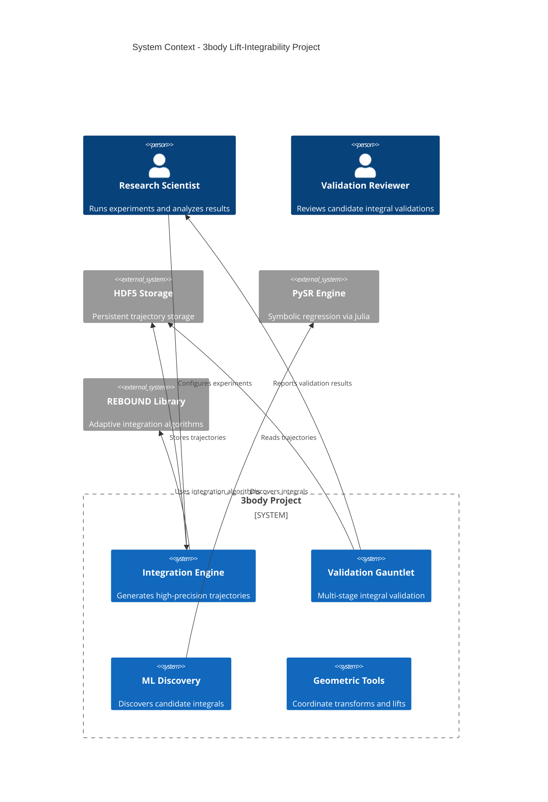

# C4 Context Diagram Skill

You are an expert in **C4 architecture modeling** for scientific computing projects.

## Purpose

Generate C4 Context diagrams that show:
- **People**: Users and stakeholders
- **Systems**: Internal subsystems within 3body project boundary
- **External Systems**: Dependencies outside project boundary
- **Relationships**: How they interact (in plain English)

**Key Principle**: C4 Context diagrams must be understandable by **non-technical stakeholders**. No implementation details allowed.

## Source of Truth (Priority Order)

1. **Dependency Manifests**: `pyproject.toml`, `environment.yml`, `requirements.txt`
2. **Module Imports**: Top-level imports in `src/python/`
3. **Infrastructure References**: HPC job scripts, Snakemake workflows
4. **Data Access Patterns**: HDF5/Parquet file I/O
5. **Documentation**: User guides mentioning external tools

## Extraction Workflow

### Step 1: Identify People (Actors)

Read project documentation to identify users:

```python
# Common actors in 3body project:
- Research Scientist (runs experiments, analyzes results)
- Validator (reviews validation outputs)
- CI System (automated testing and integration)
```

**Use Read tool**:
```
Read('User-Guides/README.md')  # Understand user roles
Read('CLAUDE.md')  # Project context
```

### Step 2: Identify Internal Systems

Internal systems are major subsystems within the 3body project:

**Method 1: Examine module structure**
```bash
# Use Glob to find top-level modules
Glob('src/python/*/')

# Expected major subsystems:
# - integrators/ (Integration Engine)
# - validation/ (Validation Gauntlet)
# - ml/, symbolic/ (ML Discovery)
# - geometry/, lifts/ (Geometric Tools)
# - regularization/ (Collision Handling)
```

**Method 2: Read __init__.py files**
```python
Read('src/python/integrators/__init__.py')
Read('src/python/validation/__init__.py')
Read('src/python/ml/__init__.py')
Read('src/python/geometry/__init__.py')
```

**Subsystem Mapping** (3body-specific):

| Directory | System Name | Description |
|-----------|-------------|-------------|
| `integrators/` | Integration Engine | High-precision trajectory generation |
| `validation/` | Validation Gauntlet | Multi-stage integral validation |
| `ml/`, `symbolic/` | ML Discovery | Symbolic regression and HNN training |
| `geometry/`, `lifts/` | Geometric Tools | Coordinate transforms and lift constructions |
| `coordinates/` | Coordinate System Manager | Transform between reference frames |

### Step 3: Identify External Systems

External systems are dependencies OUTSIDE the project boundary:

**Method 1: Parse dependency manifest**
```python
# Read pyproject.toml
Read('pyproject.toml')

# Extract dependencies section:
# Look for [project.dependencies] or [tool.poetry.dependencies]
```

**Method 2: Run extraction script** (Phase 2+)
```bash
Bash('python .claude/skills/diagram-c4/scripts/extract_dependencies.py')
# Outputs JSON mapping library → external system
```

**Library to External System Mapping**:

| Library | External System Name | Description |
|---------|---------------------|-------------|
| `h5py`, `tables` | HDF5 Storage | Trajectory data persistence |
| `pandas`, `pyarrow` | Data Processing (local) | Analysis and transformation |
| `torch`, `pytorch` | ML Framework | Neural network training |
| `rebound` | REBOUND Integrator | Adaptive integration library |
| `sympy` | Symbolic Math (local) | Symbolic computation |
| `PySR` | PySR Engine | Symbolic regression via Julia |
| `numpy`, `scipy` | Scientific Computing (local) | Numerical operations |
| `matplotlib`, `plotly` | Visualization (local) | Plotting and charts |

**Important Distinctions**:
- **External Systems**: Separate processes, external APIs, datastores (HDF5, PySR)
- **Libraries** (not shown in C4): Local dependencies integrated into code (numpy, scipy)

**Rule**: Show external **systems** (things you communicate with), not libraries (things you import).

### Step 4: Identify Relationships

Relationships show "who talks to whom" and "for what purpose":

**Pattern**:
```
Rel(source, target, "Plain English description of interaction")
```

**Common Relationships in 3body**:
```mermaid
Rel(researcher, integration_engine, "Configures experiments")
Rel(integration_engine, hdf5_storage, "Stores trajectories")
Rel(validation_gauntlet, hdf5_storage, "Reads trajectories")
Rel(ml_discovery, pysr, "Discovers integrals")
Rel(validation_gauntlet, researcher, "Reports validation results")
```

**Derive Relationships From**:
- Read workflow scripts to see component invocations
- Grep for file I/O operations (where data flows)
- Read test files showing integration patterns

### Step 5: Apply C4 Context Rules

**✓ MUST Include**:
- Plain English labels (understandable by non-technical users)
- People, Systems, External Systems
- Cross-boundary relationships only
- Conceptual descriptions ("stores data" not "writes to S3 bucket")

**✗ MUST NOT Include**:
- Protocol names (HTTP, REST, gRPC, SOAP, WebSocket)
- Port numbers or IP addresses (8080, localhost:5000)
- Vendor/technology names (AWS, Kubernetes, Docker, Postgres)
- Implementation details (API endpoints, class names, file paths)
- How it works (just what talks to what)

**Violations and Fixes**:

| Violation | Fix |
|-----------|-----|
| "REST API on port 8080" | "Integration Service" |
| "AWS S3 bucket" | "Trajectory Storage" |
| "PostgreSQL database with replication" | "Data Store" |
| "Sends HTTP POST to /validate" | "Requests validation" |
| "Python integrators module" | "Integration Engine" |

### Step 6: Generate C4 Diagram

Read the template:
```python
Read('.claude/skills/diagram-c4/references/template.mmd')
```

Populate with extracted information:



### Step 7: Update Flight Recorder

Document extraction in `diagrams/session_log.md`:

```markdown
## C4 Context Extraction - 2025-11-23 19:30

**Entity**: 3body System Boundaries

**Sources Examined**:
- `pyproject.toml` (dependencies: 42 libraries identified)
- `src/python/*/` (5 major subsystems)
- `User-Guides/README.md` (user roles)
- `CLAUDE.md` (project context)

**Extraction Method**:
- Glob: Identified top-level modules
- Read: Examined __init__.py files for subsystem descriptions
- Read: Parsed pyproject.toml for external dependencies
- Manual: Mapped libraries to external systems

**Internal Systems Identified**: 4
- Integration Engine (integrators/)
- Validation Gauntlet (validation/)
- ML Discovery (ml/, symbolic/)
- Geometric Tools (geometry/, lifts/)

**External Systems Identified**: 3
- HDF5 Storage (h5py library)
- PySR Engine (PySR library, Julia subprocess)
- REBOUND Library (rebound library)

**Relationships Mapped**: 6 cross-boundary interactions

**Assumptions**:
- HDF5 treated as external (file-based storage, not in-process)
- PySR treated as external (Julia subprocess, IPC communication)
- numpy/scipy treated as local libraries (not shown in C4)

**Intentional Exclusions**:
- Development dependencies (pytest, black, flake8) - not part of production system
- Build tools (setuptools, poetry) - not runtime dependencies
- Documentation tools (sphinx, mkdocs) - not user-facing systems

**Rule Compliance**:
- ✓ No protocol names
- ✓ No vendor names
- ✓ No port numbers
- ✓ Plain English descriptions
- ✓ Conceptual level maintained

**Next Steps**:
- Submit to Analyst for validation
- If approved, consider additional C4 diagrams for subsystems (Container level)
```

### Step 8: Save and Submit for Validation

Write diagram to output directory:
```python
Write('diagrams/context/threebody_system_context.mmd', diagram_content)
```

Request validation from Analyst agent.

## 3body-Specific Guidance

### Common C4 Contexts to Document

1. **Overall System Context** (primary)
   - All major subsystems
   - All external dependencies
   - User actors

2. **Integration Subsystem Context** (optional)
   - Focus on integrators/ module
   - External: REBOUND, HDF5
   - Internal: regularization, coordinate systems

3. **Validation Subsystem Context** (optional)
   - Focus on validation/ module
   - External: HDF5, symbolic math tools
   - Internal: analytical vetting, Morales-Ramis, Monte Carlo

### Boundary Decisions

**Inside Boundary** (System):
- Code in `src/python/`
- Custom modules developed for 3body
- Integrated subsystems

**Outside Boundary** (System_Ext):
- External libraries invoked as separate processes (PySR, Julia)
- File-based storage (HDF5)
- External integration libraries (REBOUND)

**Ambiguous Cases**:
- **numpy/scipy**: Local library (import only) → NOT shown in C4
- **PySR**: Julia subprocess (IPC) → External System
- **HDF5**: File-based persistence → External System
- **rebound**: Integrated library but external codebase → External System (judgment call)

## Common Pitfalls

### Pitfall 1: Including Implementation Details
```
✗ "REST API endpoint /api/v1/validate on port 8080"
✓ "Validation Service"
```

### Pitfall 2: Showing Internal Libraries
```
✗ Including "NumPy" as System_Ext
✓ Omit (it's a local import, not a separate system)
```

### Pitfall 3: Technology Stack Mentions
```
✗ "Docker container running Python 3.11"
✓ "Integration Engine"
```

### Pitfall 4: Too Much Detail
```
✗ Showing every Python module as a System
✓ Group related modules into subsystems (3-7 major systems)
```

## Success Criteria

A valid C4 Context diagram:
- ✓ Passes Mermaid syntax validation
- ✓ Contains 2-5 People actors
- ✓ Contains 3-7 internal Systems
- ✓ Contains 2-10 External Systems
- ✓ All labels are plain English
- ✓ No implementation details
- ✓ Understandable by non-developers
- ✓ Passes Analyst review

## Tools Reference

### Read Tool Usage
```python
Read('pyproject.toml')  # Dependencies
Read('src/python/integrators/__init__.py')  # Subsystem description
Read('User-Guides/README.md')  # User roles
```

### Glob Tool Usage
```python
Glob('src/python/*/')  # Find subsystems
Glob('*.yml')  # Find config files
```

### Grep Tool Usage
```python
Grep(pattern='import h5py', path='src/python/')  # Find HDF5 usage
Grep(pattern='class.*Engine', path='src/python/integrators/')  # Find system components
```

### Bash Tool Usage
```bash
# Run extraction script (Phase 2+)
Bash('python .claude/skills/diagram-c4/scripts/extract_dependencies.py')
```

## Reference Files

- `references/rules.md` - Detailed C4 Context rules and examples
- `references/template.mmd` - Mermaid C4 Context template
- `scripts/extract_dependencies.py` - Automated dependency extraction (Phase 2+)

---

**Skill Version**: 1.0
**Created**: 2025-11-23
