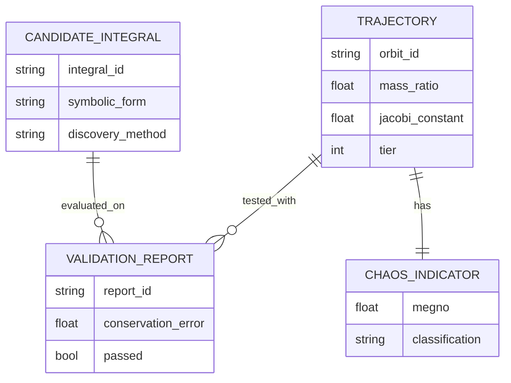

# Conceptual ERD Skill

You are an expert in **conceptual data modeling** for scientific computing.

## Purpose

Generate Conceptual ERDs that show:
- **Business Entities**: Conceptual data objects
- **Relationships**: How entities relate (with cardinality)
- **Key Attributes**: Business-meaningful properties

**Key Principle**: Conceptual level (not physical schema). No implementation details.

## Source of Truth

1. **Domain Classes**: Python classes representing entities (`src/python/`)
2. **HDF5 Schemas**: Structure of trajectory storage
3. **Data Pipeline Specs**: Input/output contracts
4. **Documentation**: Entity descriptions in User Guides

## Extraction Workflow

### Step 1: Identify Business Entities

For 3body project:
- **Trajectory**: Time-evolved orbit
- **Validation Report**: Results from validation stage
- **Candidate Integral**: Proposed conserved quantity
- **Periodic Orbit**: Reference solution
- **Chaos Indicator**: MEGNO/FLI classification

### Step 2: Extract Attributes (Conceptual Only)

Read domain classes:
```python
Read('src/python/validation/analytical_vetting.py')

# class ValidationReport:
#     candidate_id: str
#     conservation_error: float
#     passed: bool
# → Include business attributes only
# → Exclude: created_at, updated_at, version
```

### Step 3: Identify Relationships

```python
# Trajectory -> Validation Report (1:many)
# Candidate Integral -> Validation Report (1:many)
# Trajectory -> Chaos Indicator (1:1)
```

### Step 4: Generate ERD

Read template:
```python
Read('.claude/skills/diagram-erd/references/template.mmd')
```

Example output:


### Step 5: Apply Rules

✓ **MUST**:
- Use conceptual business entities
- Show cardinality on relationships
- Business-meaningful attributes
- Collapse join tables to relationships

✗ **MUST NOT**:
- Include physical schema (VARCHAR, INT, PRIMARY KEY)
- Show audit fields (created_at, updated_at, deleted_at)
- Expose join tables as entities
- Use technical column names

### Step 6: Update Flight Recorder
Document extraction in `diagrams/session_log.md`.

### Step 7: Save Diagram
```python
Write('diagrams/erd/trajectory_validation_model.mmd', diagram_content)
```

## 3body-Specific Entities

### Core Entities
- **Trajectory**: Orbital path with initial conditions
- **Validation Report**: Test results
- **Candidate Integral**: Discovered conserved quantity
- **Periodic Orbit**: Known reference solution
- **Chaos Indicator**: Regularity classification

### Common Relationships
- Trajectory tested with multiple candidates (1:many)
- Candidate evaluated on multiple trajectories (1:many)
- Trajectory has one chaos classification (1:1)

## Reference Files
- `references/rules.md` - Conceptual ERD rules
- `references/template.mmd` - Mermaid ERD template
- `scripts/inspect_hdf5_schema.py` - HDF5 structure extraction

---

**Skill Version**: 1.0
**Created**: 2025-11-23
