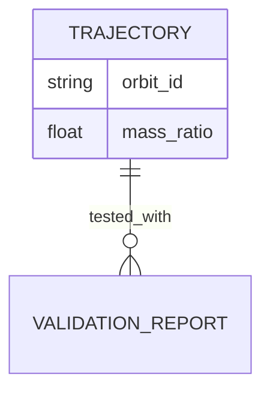

# Conceptual ERD Rules

## Core Principle
Show business entities and relationships at conceptual level (not physical schema).

## Mandatory Elements
1. **Entities**: Business objects (singular, UPPER_CASE)
2. **Relationships**: With cardinality symbols
3. **Attributes**: Business-meaningful properties only

## Rules

### ✓ MUST Include
- Business entities (conceptual level)
- Cardinality on all relationships (||--||, ||--o{, }o--||, etc.)
- Business-meaningful attributes
- Singular entity names (TRAJECTORY not TRAJECTORIES)

### ✗ MUST NOT Include
- Physical schema details (VARCHAR, INT, PRIMARY KEY, FOREIGN KEY)
- Audit columns (created_at, updated_at, deleted_at, version)
- Join tables (collapse to direct relationship)
- Technical column names (_id, fk_*, pk_*)

## Cardinality Symbols
- `||--||` : One-to-one
- `||--o{` : One-to-many
- `}o--||` : Many-to-one
- `}o--o{` : Many-to-many

## Examples

### Valid


### Invalid
```mermaid
✗ TRAJECTORY {
    VARCHAR(255) orbit_id
    TIMESTAMP created_at
  }
```

---

**Rules Version**: 1.0
