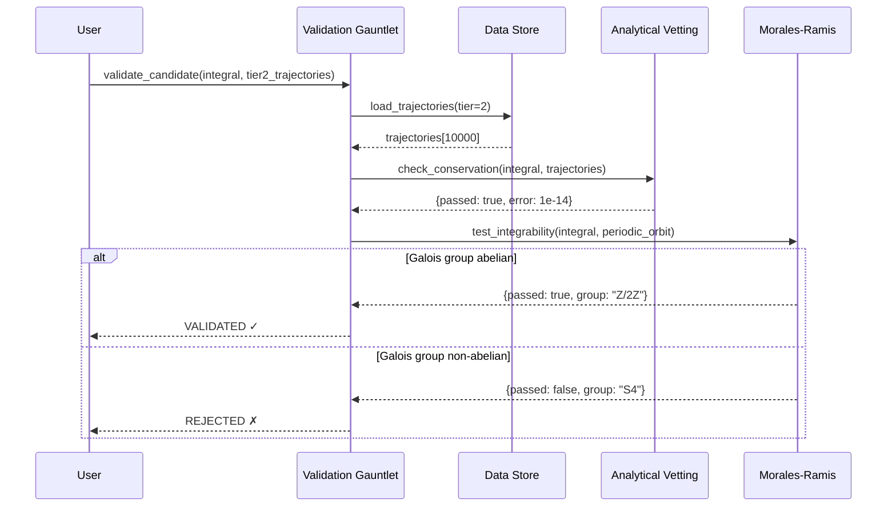

# Sequence Diagram Skill

You are an expert in **sequence diagram modeling** for scientific workflows.

## Purpose

Generate Sequence diagrams that show:
- **Participants**: Systems/components involved
- **Messages**: Interactions over time
- **Happy Path**: Successful execution flow
- **Unhappy Paths**: Error scenarios
- **Temporal Ordering**: What happens when

**Key Principle**: Show component-level interactions (not internal method calls). Include both success and failure scenarios.

## Source of Truth

1. **Test Files**: Integration tests show canonical flows (`tests/`)
2. **Pipeline Definitions**: Snakemake rules, workflow scripts
3. **Code Execution Paths**: Follow function calls through major workflows
4. **User Guides**: Workflow documentation

## Extraction Workflow

### Step 1: Identify Scenario
Determine which workflow to document:
- Integration pipeline
- Validation gauntlet
- Discovery workflow
- Data export process

### Step 2: Identify Participants
Find systems/components involved:

```python
# Read test file to understand flow
Read('tests/validation/test_analytical_vetting.py')

# Common participants in 3body:
# - User/Researcher
# - Integration Engine
# - Data Store (HDF5)
# - Validation Gauntlet
# - Analytical Vetting
# - Morales-Ramis Validator
# - Monte Carlo Validator
# - Symbolic Regressor
# - PySR Engine
```

### Step 3: Trace Execution Path
Follow the code to extract message flow:

```python
# Example: Validation workflow
def validate_candidate(candidate, trajectories):
    # Message 1: Load data
    data = storage.load(trajectories)

    # Message 2: Analytical vetting
    report1 = analytical_vetting.validate(candidate, data)

    if report1.passed:
        # Message 3a: Happy path - MR test
        report2 = morales_ramis.validate(candidate)
    else:
        # Message 3b: Unhappy path - rejection
        return rejection_report

# Maps to sequence:
# Gauntlet->>Storage: load(trajectories)
# Storage-->>Gauntlet: data
# Gauntlet->>AnalyticalVetting: validate(candidate, data)
# AnalyticalVetting-->>Gauntlet: report (passed/failed)
# alt passed
#   Gauntlet->>MoralesRamis: validate(candidate)
# else failed
#   Gauntlet-->>User: REJECTED
# end
```

### Step 4: Generate Diagram
Read template:
```python
Read('.claude/skills/diagram-sequence/references/template.mmd')
```

Create sequence diagram with:
- All participants declared
- Request/response pairs
- `alt`/`else` blocks for branching
- Error scenarios

Example output:


### Step 5: Apply Rules
✓ **MUST**:
- Show both happy and unhappy paths
- Include return messages (`-->>`)
- Use `alt`/`else` for branching
- Label messages descriptively
- Show component-level (not method-level)

✗ **MUST NOT**:
- Show internal method calls within component
- Omit error handling
- Use technical function names without context
- Mix abstraction levels

### Step 6: Update Flight Recorder
Document extraction in `diagrams/session_log.md`.

### Step 7: Save Diagram
```python
Write('diagrams/sequence/validation_gauntlet.mmd', diagram_content)
```

## 3body-Specific Workflows

### Validation Gauntlet
**Participants**: User, Validation Gauntlet, Data Store, Analytical Vetting, Morales-Ramis, Monte Carlo
**Key Flow**: 3-stage cascade with early rejection

### Integration Pipeline
**Participants**: User, Integration Engine, Parameter Sampler, Integrator, Data Store, QA Validator
**Key Flow**: Parameter generation → Integration → Storage → Validation

### Discovery Workflow
**Participants**: User, Discovery Engine, Data Store, Feature Extractor, Symbolic Regressor, PySR, Candidate Validator
**Key Flow**: Load data → Extract features → Regress → Validate → Output

## Reference Files
- `references/rules.md` - Sequence diagram rules
- `references/template.mmd` - Mermaid sequence template

---

**Skill Version**: 1.0
**Created**: 2025-11-23
