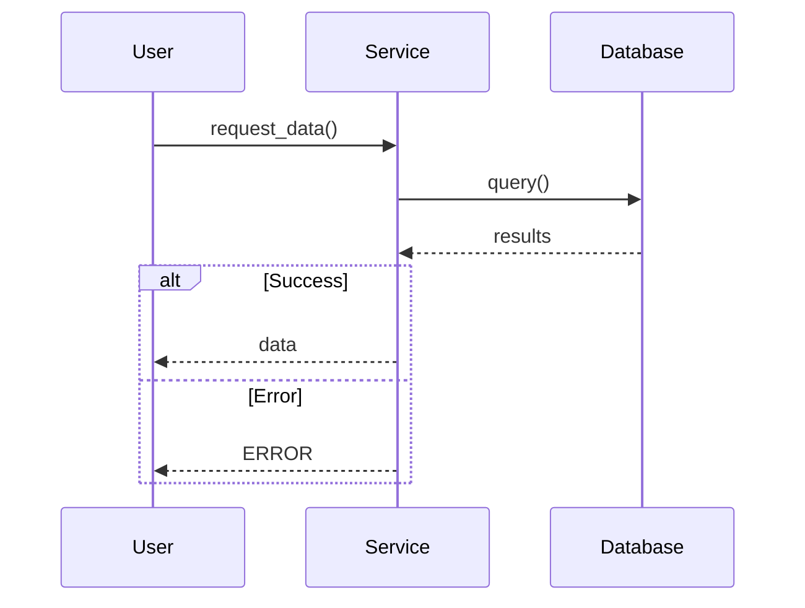

# Sequence Diagram Rules

## Core Principle
Show message flow between components over time. Include both success and failure paths.

## Mandatory Elements
1. **Participants**: All systems/components involved
2. **Request Messages**: Use `->>` (solid arrow)
3. **Response Messages**: Use `-->>` (dashed arrow)
4. **Control Flow**: Use `alt`/`else`/`opt`/`loop` for branching/iteration
5. **Error Handling**: Show failure scenarios

## Rules

### ✓ MUST Include
- All participants declared at top
- Both happy and unhappy paths
- Return messages for requests
- Error handling blocks (`alt`/`else`)
- Component-level interactions (not method-level)
- Descriptive message labels

### ✗ MUST NOT Include
- Internal method calls within single component
- Implementation details (protocols, formats)
- Missing error paths
- Orphaned requests (no response)

## Examples

### Valid


### Invalid
```mermaid
✗ Missing error handling
✗ No return arrows
✗ Shows private methods
```

---

**Rules Version**: 1.0
