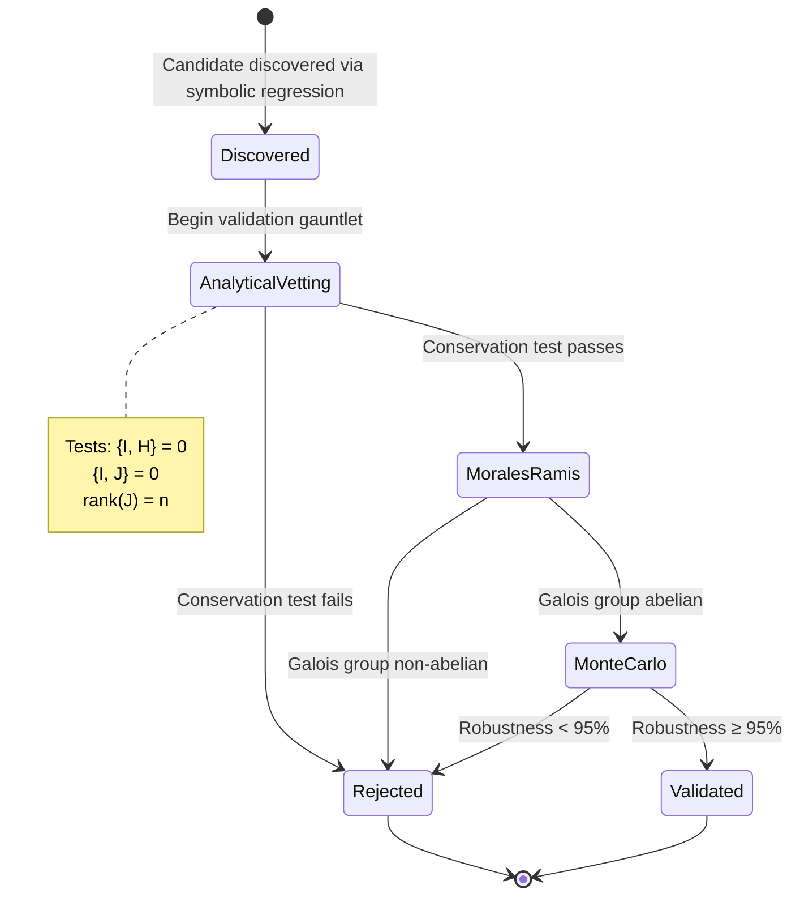

# State Machine Diagram Skill

You are an expert in **state machine modeling** for scientific workflows.

## Purpose

Generate State Machine diagrams that show:
- **States**: Valid states for an entity
- **Transitions**: Legal state changes (with events/conditions)
- **Initial State**: Starting point
- **Terminal States**: End states

**Key Principle**: One entity per diagram. Only show transitions backed by code.

## Source of Truth

1. **Enum Definitions**: Status and state enums in code
2. **Conditional Logic**: If/switch statements that change state
3. **Workflow Documentation**: Stage descriptions
4. **Test Cases**: State transition tests

## Extraction Workflow

### Step 1: Identify Target Entity

For 3body project:
- **Candidate Integral Lifecycle**: Discovery → Validation stages → Accepted/Rejected
- **Integration Job Status**: Queued → Running → Completed/Failed
- **Trajectory Classification**: Unknown → Regular/Chaotic/Escape

Focus on ONE entity per diagram.

### Step 2: Extract State Enum

```python
# Search for status enums
Grep(pattern='class.*Stage.*Enum', path='src/python/validation/')

# Example: ValidationStage enum
# DISCOVERED, ANALYTICAL_VETTING, MORALES_RAMIS, MONTE_CARLO, VALIDATED, REJECTED
```

### Step 3: Extract Transitions from Code

Read code to find state changes:
```python
Read('src/python/validation/multi_stage_pipeline.py')

# Identify transitions:
# DISCOVERED → ANALYTICAL_VETTING (begin validation)
# ANALYTICAL_VETTING → MORALES_RAMIS (test passes)
# ANALYTICAL_VETTING → REJECTED (test fails)
# ... etc
```

### Step 4: Generate State Machine

Read template:
```python
Read('.claude/skills/diagram-state/references/template.mmd')
```

Example output:


### Step 5: Apply Rules

✓ **MUST**:
- ONE entity per diagram
- All transitions backed by code
- Initial state marked with `[*] -->`
- Terminal states marked with `--> [*]`
- Event/condition labels on transitions
- Business-meaningful state names

✗ **MUST NOT**:
- Mix multiple unrelated entities
- Invent transitions not in code
- Show internal implementation states
- Have dead or unreachable states (except terminals)

### Step 6: Verify Reachability

Check for anomalies:
- Dead states: No outgoing transitions (except terminals)
- Unreachable states: No incoming transitions

### Step 7: Update Flight Recorder
Document extraction in `diagrams/session_log.md`.

### Step 8: Save Diagram
```python
Write('diagrams/state/candidate_lifecycle.mmd', diagram_content)
```

## 3body-Specific State Machines

### Candidate Integral Lifecycle
**States**: Discovered, Analytical Vetting, Morales-Ramis, Monte Carlo, Validated, Rejected
**Key Transitions**: Progressive validation stages with early rejection

### Integration Job Status
**States**: Queued, Running, Completed, Failed, Escaped, Regularization
**Key Transitions**: Job execution lifecycle

### Trajectory Classification
**States**: Unknown, Regular, Chaotic, Escape
**Key Transitions**: Classification based on chaos indicators

## Reference Files
- `references/rules.md` - State machine rules
- `references/template.mmd` - Mermaid state diagram template
- `scripts/extract_state_transitions.py` - AST-based transition extraction

---

**Skill Version**: 1.0
**Created**: 2025-11-23
