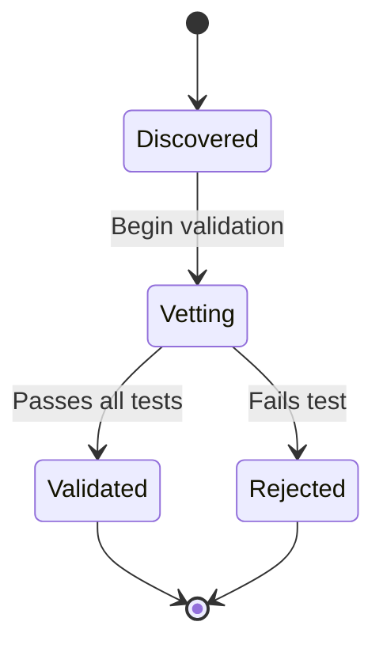

# State Machine Diagram Rules

## Core Principle
Show entity lifecycle and valid state transitions. One entity per diagram.

## Mandatory Elements
1. **Initial State**: Marked with `[*] --> FirstState`
2. **States**: Valid states for the entity
3. **Transitions**: With event/condition labels
4. **Terminal States**: Marked with `State --> [*]`

## Rules

### ✓ MUST Include
- ONE entity focus (not multiple unrelated entities)
- All transitions backed by code
- Initial state marker `[*]`
- Terminal state markers `[*]`
- Meaningful event/condition labels on transitions
- Clear, business-meaningful state names

### ✗ MUST NOT Include
- Multiple unrelated entities mixed together
- Transitions not backed by code (hypothetical)
- Dead states (no outgoing, except terminals)
- Unreachable states (no incoming from initial)
- Technical state names (STATE_001, ERROR_FLAG)

## Transition Syntax
```
StateA --> StateB : Event or condition
```

## Examples

### Valid


### Invalid
```mermaid
✗ Mixed entities (Trajectory + Validation states)
✗ Orphaned state with no transitions
✗ Hypothetical transitions not in code
```

## Verification Checks
- [ ] All states reachable from initial
- [ ] No dead states (except terminals)
- [ ] All transitions have labels
- [ ] Single entity focus

---

**Rules Version**: 1.0
