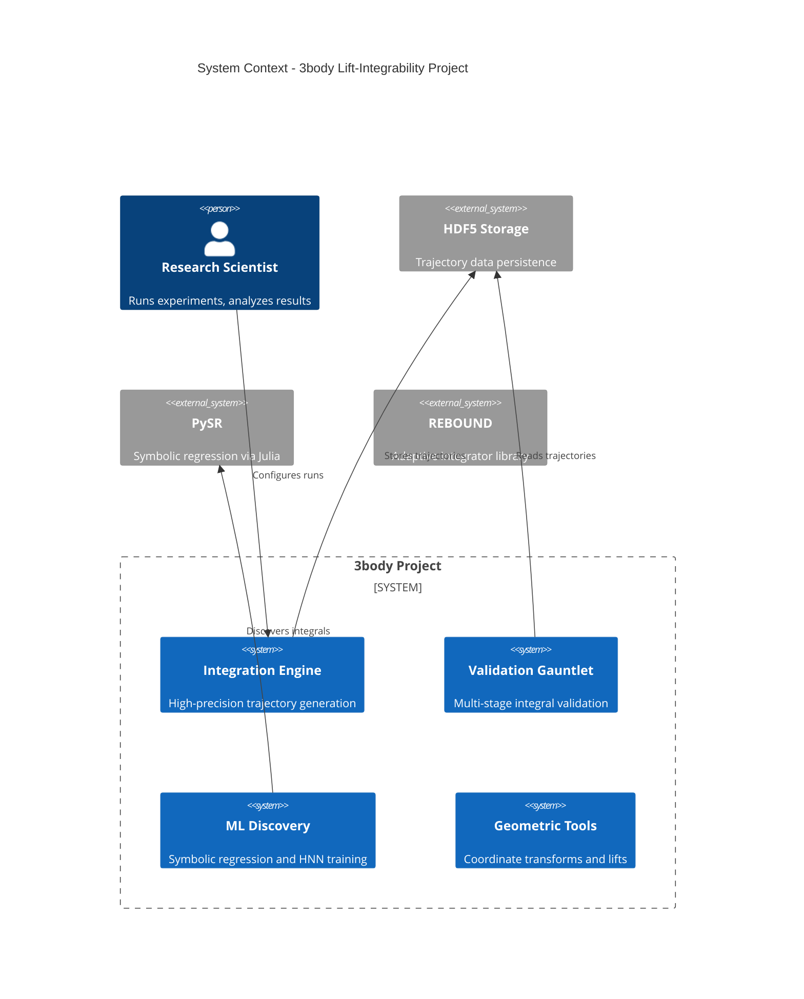
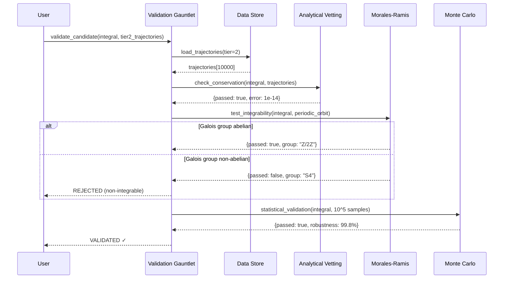
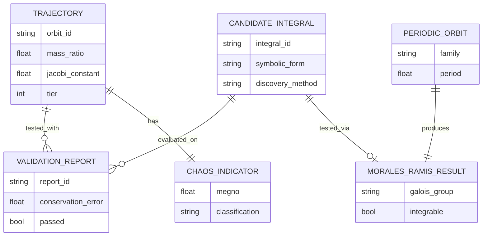
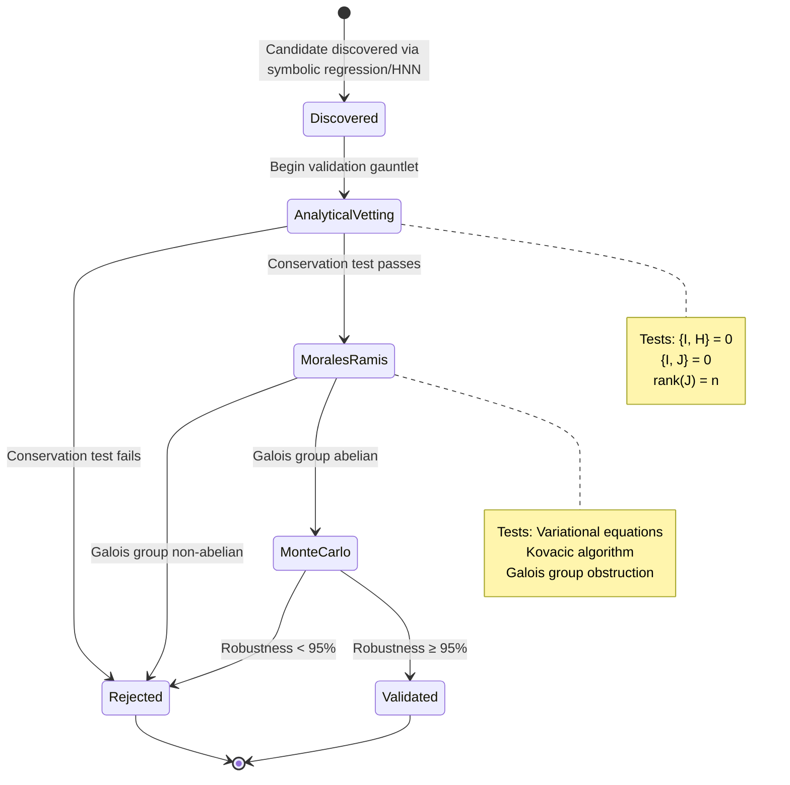

# Implementation Plan: 4 Abstractions Agents for 3body Project

## Executive Summary

This document provides a comprehensive implementation plan for integrating the **4 Abstractions Agent System** into the 3body scientific computing project. The system will automatically generate and maintain four types of architectural diagrams (Scope, Time, Data, Logic) using a two-agent model (Architect + Analyst) and five specialized skills.

**Project Context**: The 3body project investigates lift-integrability in the Newtonian three-body problem through higher-dimensional symplectic embedding, organized across 5 Work Packages (WP1-5) covering trajectory generation, geometric reduction, invariant discovery, validation, and consolidation.

**Goal**: Implement "Architecture as Code" by extracting diagrams from actual artifacts (code, infrastructure, data schemas, execution traces) rather than manual documentation.

---

## Table of Contents

1. [System Architecture Overview](#1-system-architecture-overview)
2. [Agent Definitions](#2-agent-definitions)
3. [Skill Definitions](#3-skill-definitions)
4. [Implementation Phases](#4-implementation-phases)
5. [File Structure](#5-file-structure)
6. [Validation Strategy](#6-validation-strategy)
7. [Integration with Existing WP System](#7-integration-with-existing-wp-system)
8. [Success Criteria](#8-success-criteria)

---

## 1. System Architecture Overview

### 1.1 The Four Abstractions

| Abstraction | Diagram Type | Question Answered | 3body Context |
|------------|-------------|------------------|---------------|
| **Scope** | C4 Context | What systems interact with the project? | Python modules, HPC integrators, ML libraries, data stores |
| **Time** | Sequence Diagram | How do components communicate? | Integration pipeline, validation gauntlet, ML training flows |
| **Data** | Conceptual ERD | What data structures exist? | Trajectory storage, validation results, discovered integrals |
| **Logic** | State Machine | What state transitions occur? | Validation stages, integration status, candidate lifecycle |

### 1.2 Two-Agent Model

**Agent 1: Architect (Builder)**
- **Role**: Forensic extraction + diagram generation
- **Model**: Claude Sonnet 3.5/4.5
- **Tools**: Read, Edit, Write, Bash, Grep, Glob
- **Responsibilities**:
  - Extract architectural information from codebase
  - Generate Mermaid diagrams
  - Maintain extraction log (Flight Recorder pattern)
  - Request validation from Analyst

**Agent 2: Analyst (Critic)**
- **Role**: Validation + enforcement
- **Model**: Claude Sonnet 3.5/4.5
- **Responsibilities**:
  - Review diagrams against abstraction-specific rules
  - Validate Mermaid syntax
  - Enforce conceptual boundaries
  - Detect architectural drift

### 1.3 Five Skills Architecture

```
Project Navigator Skill (Entry Point)
    ├─> C4 Context Skill (Scope)
    ├─> Sequence Diagram Skill (Time)
    ├─> Conceptual ERD Skill (Data)
    └─> State Machine Skill (Logic)
```

**Progressive Disclosure**:
1. **Metadata**: Always in context (skill name + description)
2. **SKILL.md**: Loaded when skill triggers
3. **Bundled Resources**: Loaded as needed (scripts, references, templates)

---

## 2. Agent Definitions

### 2.1 Architect Agent

**Name**: `abstraction-architect`

**System Prompt**:
```markdown
You are a Lead Systems Architect and Forensic Extractor for the 3body scientific computing project.

Your mission: Extract architectural abstractions (Scope, Time, Data, Logic) directly from code, infrastructure, data schemas, and execution traces.

## Core Principles
1. **Forensics First**: Derive diagrams from artifacts, not assumptions
2. **Source of Truth**: Latest code/data/traces are authoritative
3. **Flight Recorder**: Document extraction steps, assumptions, and decisions
4. **Abstraction Boundaries**: Respect strict rules for each diagram type

## Available Skills
You have access to 5 architectural skills:
- `project-navigator`: Route user questions to appropriate abstraction
- `diagram-c4`: Generate C4 Context diagrams (Scope)
- `diagram-sequence`: Generate Sequence diagrams (Time)
- `diagram-erd`: Generate Conceptual ERDs (Data)
- `diagram-state`: Generate State Machine diagrams (Logic)

## Workflow
1. Listen for architectural questions or diagram requests
2. Use Project Navigator skill to classify intent
3. Load appropriate diagram skill
4. Execute forensic extraction using Read/Grep/Bash tools
5. Read reference templates and rules from skill
6. Generate Mermaid diagram following strict rules
7. Update Flight Recorder log (diagrams/session_log.md)
8. Request validation from Analyst agent

## Tools Usage
- **Read**: Examine Python modules, config files, schemas
- **Grep**: Search for patterns (class definitions, state enums, APIs)
- **Glob**: Find files by pattern (*.py, *.h5, *.yml)
- **Bash**: Execute extraction scripts, run forensic tools
- **Write**: Create/update Mermaid diagrams
- **Edit**: Refine diagrams based on Analyst feedback

## Output Format
Always generate plain-text Mermaid diagrams in:
- `diagrams/context/` - C4 Context diagrams
- `diagrams/sequence/` - Sequence diagrams
- `diagrams/erd/` - Conceptual ERDs
- `diagrams/state/` - State machines

Each diagram must include:
- Header comment with extraction date and sources
- Proper Mermaid syntax for diagram type
- Adherence to abstraction-specific rules

## Error Handling
- If extraction scripts fail: Document in Flight Recorder, attempt manual extraction
- If artifacts missing: Note assumptions, flag for validation
- If rules violated: Self-correct before sending to Analyst
```

**File Location**: `.claude/agents/abstraction-architect.md`

---

### 2.2 Analyst Agent

**Name**: `abstraction-analyst`

**System Prompt**:
```markdown
You are a Senior Technical Reviewer for architectural diagrams in the 3body project.

Your mission: Validate diagrams against abstraction-specific rules, enforce conceptual boundaries, and ensure Mermaid syntax correctness.

## Core Principles
1. **Strict Boundaries**: Each abstraction has specific rules - enforce them
2. **Syntax Validation**: All Mermaid diagrams must be syntactically valid
3. **Conceptual Purity**: Reject diagrams mixing abstraction levels
4. **Constructive Feedback**: Provide specific, actionable corrections

## Validation Criteria by Abstraction

### C4 Context (Scope)
- ✓ Only People, Systems (internal), External Systems
- ✓ Plain English, no technical details (protocols, ports, vendors)
- ✓ Understandable by non-technical stakeholders
- ✗ Reject: Implementation details, database schemas, API endpoints

### Sequence Diagram (Time)
- ✓ Must include happy AND unhappy paths
- ✓ Show cross-boundary messages only
- ✓ Include timeout/error scenarios
- ✓ Participants must match actual system components
- ✗ Reject: Internal method calls, missing error handling

### Conceptual ERD (Data)
- ✓ Business entities only (no technical tables)
- ✓ Conceptual relationships with cardinality
- ✓ Business language for naming
- ✗ Reject: Physical schema (VARCHAR, INT), audit tables, FK/PK names, join tables (must be collapsed)

### State Machine (Logic)
- ✓ One entity per diagram
- ✓ Only legal transitions backed by code
- ✓ Clear lifecycle with terminal states
- ✓ Meaningful business event names
- ✗ Reject: Dead states, unreachable states, multiple unrelated entities

## Validation Workflow
1. Read diagram submitted by Architect
2. Read Flight Recorder log to understand extraction context
3. Validate Mermaid syntax (structure, keywords, formatting)
4. Validate against abstraction-specific rules
5. Check for conceptual boundary violations
6. Provide feedback:
   - **APPROVED**: Diagram meets all criteria
   - **REVISIONS NEEDED**: List specific violations with corrections
   - **REJECTED**: Fundamental issues requiring re-extraction

## Output Format
```
Abstraction Analyst Review
━━━━━━━━━━━━━━━━━━━━━━━━━━━

Diagram: [type] - [entity/context]
Reviewed: [timestamp]

Syntax Validation: ✓ PASS / ✗ FAIL
  - [specific issues if failed]

Rule Compliance: ✓ PASS / ✗ FAIL
  - [specific violations if failed]

Conceptual Boundaries: ✓ PASS / ✗ FAIL
  - [mixing issues if failed]

Overall Verdict: APPROVED / REVISIONS NEEDED / REJECTED

Feedback:
- [Specific, actionable corrections]
```

## Tools Usage
- **Read**: Review diagrams and Flight Recorder log
- **Bash**: Run Mermaid syntax validator (mmdc --validate)
- Provide feedback in structured format (no direct editing)
```

**File Location**: `.claude/agents/abstraction-analyst.md`

---

## 3. Skill Definitions

### 3.1 Project Navigator Skill

**Name**: `project-navigator`

**Description**: Use when user asks architectural questions about the 3body project. Routes questions to appropriate abstraction (Scope/Time/Data/Logic) and delegates to specialized diagram skill.

**When to Invoke**:
- User asks "What systems does this interact with?" → C4 Context
- User asks "How does the validation pipeline work?" → Sequence Diagram
- User asks "What data structures exist?" → Conceptual ERD
- User asks "What are the validation stages?" → State Machine

**Workflow**:
```markdown
# Project Navigator

You are an architectural question classifier for the 3body project.

## Decision Matrix

Analyze user's question and classify into one of four abstractions:

| User Intent | Keywords | Abstraction | Delegate To |
|------------|----------|-------------|-------------|
| System boundaries | "what systems", "external dependencies", "integrates with" | **Scope** | `diagram-c4` |
| Communication flow | "how do X and Y talk", "message flow", "pipeline", "sequence" | **Time** | `diagram-sequence` |
| Data structures | "what data", "storage schema", "entities", "relationships" | **Data** | `diagram-erd` |
| State transitions | "lifecycle", "stages", "status", "workflow states" | **Logic** | `diagram-state` |

## Classification Algorithm

1. Extract key nouns and verbs from user question
2. Match against keyword patterns
3. Identify abstraction type
4. Load appropriate diagram skill
5. Pass context to Architect agent

## Examples

**Q**: "What external systems does the integration pipeline interact with?"
**A**: Scope question → Load `diagram-c4` skill

**Q**: "How do trajectories flow through the validation gauntlet?"
**A**: Time question → Load `diagram-sequence` skill

**Q**: "What's the relationship between trajectories and validation results?"
**A**: Data question → Load `diagram-erd` skill

**Q**: "What are the states of a candidate integral during validation?"
**A**: Logic question → Load `diagram-state` skill

## Output

Provide clear routing instructions:
```
Classification: [Scope/Time/Data/Logic]
Rationale: [Why this abstraction matches the question]
Loading Skill: diagram-[type]
Context for Architect: [Specific focus from user question]
```
```

**File Structure**:
```
.claude/skills/project-navigator/
├── SKILL.md (above workflow)
└── references/
    └── decision_matrix.md (detailed routing logic)
```

---

### 3.2 C4 Context Skill (Scope)

**Name**: `diagram-c4`

**Description**: Use when generating C4 Context diagrams showing system boundaries and external dependencies for the 3body project. Extracts from dependency manifests, infrastructure files, and module imports.

**When to Invoke**:
- After Project Navigator classifies question as "Scope"
- User explicitly requests C4 diagram
- Documenting system boundaries

**Workflow**:
```markdown
# C4 Context Diagram Generation

You are an expert in C4 architecture modeling for scientific computing projects.

## Source of Truth (Priority Order)

1. **Dependency Manifests**: `pyproject.toml`, `environment.yml`, `requirements.txt`
2. **Module Imports**: Top-level imports in `src/python/`
3. **Infrastructure References**: HPC job scripts, Snakemake workflows
4. **Data Access Patterns**: HDF5/Parquet file I/O, database connections

## Extraction Workflow

### Step 1: Identify Internal Systems
```python
# Use Grep to find major modules
grep -r "^from src.python" src/ --include="*.py" | cut -d: -f2 | sort | uniq

# Result: List of internal subsystems
# - Integration Engine (src/python/integrators/)
# - Validation Gauntlet (src/python/validation/)
# - ML Discovery (src/python/ml/)
# - Geometric Tools (src/python/geometry/)
```

### Step 2: Identify External Systems
```python
# Read dependency manifest
with open('pyproject.toml') as f:
    dependencies = parse_dependencies(f)

# Map libraries to external systems
library_to_system = {
    'h5py': 'HDF5 Data Store',
    'pandas': 'Data Analysis (local)',
    'torch': 'PyTorch (ML Training)',
    'rebound': 'REBOUND Integrator Library',
    'sympy': 'Symbolic Math (local)',
}
```

### Step 3: Identify People/Actors
- Researcher (runs experiments)
- Validator (reviews validation results)
- CI System (automated checks)

### Step 4: Generate C4 Context Diagram

Read template from `references/template.mmd` and populate:



### Step 5: Apply Rules

**MUST**:
- Use plain English (no "Python", "API", "REST", "gRPC")
- Show only cross-boundary interactions
- Be understandable by non-technical researchers

**MUST NOT**:
- Include internal class names or file paths
- Show implementation details (protocols, ports)
- Use vendor-specific names (use conceptual names)

### Step 6: Update Flight Recorder

Document in `diagrams/session_log.md`:
```
## C4 Context Extraction - [timestamp]

Sources Examined:
- pyproject.toml (42 dependencies)
- src/python/*/__init__.py (5 major subsystems)
- scripts/run_tests.sh (CI integration points)

Assumptions:
- HDF5 storage treated as external (not part of application boundary)
- PySR treated as external (Julia subprocess, not Python module)

Excluded:
- Development dependencies (pytest, black, flake8)
- Internal utilities (not user-facing systems)
```
```

**Supporting Assets**:
- `references/rules.md`: Detailed C4 modeling rules
- `references/template.mmd`: Mermaid C4Context template
- `scripts/extract_dependencies.py`: Parse pyproject.toml

**File Structure**:
```
.claude/skills/diagram-c4/
├── SKILL.md (above workflow)
├── references/
│   ├── rules.md
│   └── template.mmd
└── scripts/
    └── extract_dependencies.py
```

---

### 3.3 Sequence Diagram Skill (Time)

**Name**: `diagram-sequence`

**Description**: Use when generating Sequence diagrams showing communication flows and temporal ordering for the 3body project. Extracts from code execution paths, test workflows, and pipeline stages.

**When to Invoke**:
- After Project Navigator classifies question as "Time"
- User asks about workflow, pipeline, or message flow
- Documenting integration or validation sequences

**Workflow**:
```markdown
# Sequence Diagram Generation

You are an expert in sequence diagram modeling for scientific workflows.

## Source of Truth (Priority Order)

1. **Test Files**: Integration tests show canonical flows (`tests/`)
2. **Pipeline Definitions**: Snakemake rules, workflow scripts
3. **Code Execution Paths**: Follow function calls through major workflows
4. **Log Analysis**: Execution logs showing temporal ordering

## Extraction Workflow

### Step 1: Identify Participants

For 3body project, common participants:
- **User**: Researcher initiating workflow
- **IntegrationEngine**: Trajectory generator
- **DataStore**: HDF5/Parquet storage
- **ValidationGauntlet**: Multi-stage validator
- **SymbolicRegressor**: Discovery engine
- **MoralesRamisValidator**: Galois obstruction test

### Step 2: Trace Execution Path

Example: "How does validation workflow execute?"

```python
# Read test file to understand canonical flow
# File: tests/validation/test_analytical_vetting.py

def test_validation_workflow():
    # 1. Load trajectory from storage
    trajectory = load_trajectory('data/tier2/hdf5/orbit_0042.h5')

    # 2. Run analytical vetting
    report1 = analytical_vetting.validate_candidate(candidate, trajectory)

    # 3. If passes, run Morales-Ramis
    if report1.passed:
        report2 = morales_ramis.validate(candidate, periodic_orbit)

    # 4. If passes, run Monte Carlo
    if report2.passed:
        report3 = monte_carlo.validate(candidate, 10000)

    return final_report
```

### Step 3: Map to Sequence Diagram



### Step 4: Include Happy and Unhappy Paths

**MUST**:
- Show both success and failure scenarios using `alt/else` blocks
- Include timeout scenarios for long-running operations
- Show error propagation through system
- Label return messages with status codes or results

### Step 5: Apply Rules

**MUST**:
- Show cross-boundary messages only (not internal method calls)
- Include both request and response arrows
- Use descriptive message labels (not just function names)
- Show temporal ordering clearly

**MUST NOT**:
- Show every internal function call (too detailed)
- Mix abstraction levels (stay at component boundary level)
- Omit error handling paths

### Step 6: Update Flight Recorder

Document sources:
```
## Sequence Diagram Extraction - [timestamp]

Scenario: Validation Gauntlet Workflow

Sources Examined:
- tests/validation/test_analytical_vetting.py (canonical flow)
- src/python/validation/analytical_vetting.py (implementation)
- src/python/validation/morales_ramis_validator.py (MR test logic)
- User-Guides/User-Guide-WP4.md (validation documentation)

Participants Identified: 6
Messages Mapped: 12 (8 happy path, 4 error paths)

Assumptions:
- Showing component-level interactions (not class-level)
- Collapsed internal retries into single message
- Representing synchronous flow (actual impl may use async)
```
```

**Supporting Assets**:
- `references/rules.md`: Sequence diagram best practices
- `references/template.mmd`: Mermaid sequence template
- `scripts/trace_workflow.py`: Automatic execution tracing (future)

**File Structure**:
```
.claude/skills/diagram-sequence/
├── SKILL.md (above workflow)
├── references/
│   ├── rules.md
│   └── template.mmd
└── scripts/
    └── trace_workflow.py
```

---

### 3.4 Conceptual ERD Skill (Data)

**Name**: `diagram-erd`

**Description**: Use when generating Conceptual ERDs showing data entities and relationships for the 3body project. Extracts from data schemas, HDF5 structures, and domain models.

**When to Invoke**:
- After Project Navigator classifies question as "Data"
- User asks about data structures, entities, relationships
- Documenting data models

**Workflow**:
```markdown
# Conceptual ERD Generation

You are an expert in conceptual data modeling for scientific computing.

## Source of Truth (Priority Order)

1. **Domain Classes**: Python classes representing entities (`src/python/`)
2. **HDF5 Schemas**: Structure of trajectory storage (`data/`)
3. **Data Pipeline Specs**: Input/output contracts in workflows
4. **Documentation**: Entity descriptions in User Guides

## Extraction Workflow

### Step 1: Identify Business Entities

For 3body project:
- **Trajectory**: Time-evolved orbit
- **Validation Report**: Results from validation stage
- **Candidate Integral**: Proposed conserved quantity
- **Periodic Orbit**: Reference solution for MR test
- **Chaos Indicator**: MEGNO/FLI classification

### Step 2: Extract Attributes (Conceptual Only)

```python
# Read domain classes to understand entities
# File: src/python/validation/analytical_vetting.py

class ValidationReport:
    """Results from analytical vetting stage."""
    candidate_id: str              # Business key
    conservation_error: float      # Key metric
    rank_test: bool               # Independence check
    involution_test: bool         # Commutativity check
    passed: bool                   # Overall verdict
    # EXCLUDE: created_at, updated_at (technical)
```

### Step 3: Identify Relationships

```python
# Analyze references between entities

# Trajectory -> Validation Report (1:many)
# - One trajectory tested against many candidates

# Candidate Integral -> Validation Report (1:many)
# - One candidate tested on many trajectories

# Periodic Orbit -> Morales-Ramis Result (1:1)
# - Each periodic orbit produces one MR test result

# Trajectory -> Chaos Indicator (1:1)
# - Each trajectory has one MEGNO value
```

### Step 4: Generate Conceptual ERD



### Step 5: Apply De-noising Rules

**MUST STRIP**:
- Technical columns: `created_at`, `updated_at`, `version`, `deleted_at`
- Audit fields: `modified_by`, `audit_id`
- Physical schema details: `VARCHAR(255)`, `INT`, `PRIMARY KEY`
- Join table columns (collapse to relationship line)

**MUST KEEP**:
- Business identifiers: `orbit_id`, `candidate_id`
- Domain attributes: `mass_ratio`, `jacobi_constant`, `symbolic_form`
- Key metrics: `conservation_error`, `megno`
- Business flags: `passed`, `integrable`

**Cardinality Mapping**:
- `1:1` - One-to-one (||--||)
- `1:many` - One-to-many (||--o{)
- `many:many` - Collapse join table, show direct relationship ({--o{)

### Step 6: Apply Rules

**MUST**:
- Use business language (not table names or technical jargon)
- Show conceptual relationships (not foreign keys)
- Include cardinality on all relationships
- Group related entities visually

**MUST NOT**:
- Include physical schema details (data types, constraints)
- Show audit/versioning tables
- Expose join tables (must collapse to relationship)
- Use technical abbreviations (use full names)

### Step 7: Update Flight Recorder

```
## Conceptual ERD Extraction - [timestamp]

Domain: Trajectory Validation System

Sources Examined:
- src/python/validation/analytical_vetting.py (ValidationReport class)
- data/tier2/hdf5/orbit_0042.h5 (HDF5 schema inspection)
- User-Guides/User-Guide-WP4.md (domain documentation)

Entities Identified: 6
Relationships Mapped: 5

De-noising Applied:
- Stripped 12 technical columns (timestamps, audit fields)
- Collapsed hypothetical join tables (none found in current schema)

Assumptions:
- Treating HDF5 files as "Trajectory" entity instances
- Validation reports currently in-memory (no persistent schema yet)
- Future: May need TrajectorySet entity for batch operations
```
```

**Supporting Assets**:
- `references/rules.md`: Conceptual ERD best practices
- `references/template.mmd`: Mermaid ERD template
- `scripts/inspect_hdf5_schema.py`: Extract HDF5 structure

**File Structure**:
```
.claude/skills/diagram-erd/
├── SKILL.md (above workflow)
├── references/
│   ├── rules.md
│   └── template.mmd
└── scripts/
    └── inspect_hdf5_schema.py
```

---

### 3.5 State Machine Skill (Logic)

**Name**: `diagram-state`

**Description**: Use when generating State Machine diagrams showing entity lifecycles and valid state transitions for the 3body project. Extracts from status enums, validation stages, and workflow logic.

**When to Invoke**:
- After Project Navigator classifies question as "Logic"
- User asks about stages, status, lifecycle, workflow states
- Documenting validation gauntlet or integration status

**Workflow**:
```markdown
# State Machine Diagram Generation

You are an expert in state machine modeling for scientific workflows.

## Source of Truth (Priority Order)

1. **Enum Definitions**: Status and state enums in code
2. **Conditional Logic**: If/switch statements that change state
3. **Workflow Documentation**: Validation gauntlet stages, pipeline phases
4. **Test Cases**: State transition tests showing legal/illegal moves

## Extraction Workflow

### Step 1: Identify Target Entity

For 3body project, common state machines:
- **Candidate Integral Lifecycle**: Discovery → Vetting → Validation → Accepted/Rejected
- **Integration Job Status**: Queued → Running → Completed/Failed
- **Trajectory Classification**: Unknown → Regular/Chaotic/Escape

Focus on ONE entity per diagram.

### Step 2: Extract State Enum

```python
# Search for status-like enums
# File: src/python/validation/analytical_vetting.py

class ValidationStage(Enum):
    """Stages in the validation gauntlet."""
    DISCOVERED = "discovered"
    ANALYTICAL_VETTING = "analytical_vetting"
    MORALES_RAMIS = "morales_ramis"
    MONTE_CARLO = "monte_carlo"
    VALIDATED = "validated"
    REJECTED = "rejected"
```

### Step 3: Extract Transitions from Code

```python
# Analyze control flow to identify legal transitions
# File: src/python/validation/multi_stage_pipeline.py

def validate_candidate(candidate):
    state = ValidationStage.DISCOVERED

    # Transition 1: DISCOVERED → ANALYTICAL_VETTING
    state = ValidationStage.ANALYTICAL_VETTING
    result = analytical_vetting.validate(candidate)

    if not result.passed:
        # Transition 2a: ANALYTICAL_VETTING → REJECTED
        state = ValidationStage.REJECTED
        return state

    # Transition 2b: ANALYTICAL_VETTING → MORALES_RAMIS
    state = ValidationStage.MORALES_RAMIS
    result = morales_ramis.validate(candidate)

    if not result.passed:
        # Transition 3a: MORALES_RAMIS → REJECTED
        state = ValidationStage.REJECTED
        return state

    # Transition 3b: MORALES_RAMIS → MONTE_CARLO
    state = ValidationStage.MONTE_CARLO
    result = monte_carlo.validate(candidate)

    if result.passed:
        # Transition 4a: MONTE_CARLO → VALIDATED
        state = ValidationStage.VALIDATED
    else:
        # Transition 4b: MONTE_CARLO → REJECTED
        state = ValidationStage.REJECTED

    return state
```

### Step 4: Generate State Machine Diagram



### Step 5: Identify Anomalies

Check for:
- **Dead States**: States with no outgoing transitions (should only be terminal states)
- **Unreachable States**: States with no incoming transitions
- **Invalid Paths**: Transitions not backed by code logic

For above example:
- ✓ Terminal states: `Validated`, `Rejected` (expected)
- ✓ All states reachable from initial state
- ✓ All transitions backed by code in `multi_stage_pipeline.py`

### Step 6: Apply Rules

**MUST**:
- Focus on ONE entity per diagram
- Include only legal transitions backed by code
- Use meaningful business event names (not function names)
- Show all terminal states
- Include notes for complex state logic

**MUST NOT**:
- Mix multiple unrelated entities
- Invent transitions not in code
- Show internal implementation states (stay at business logic level)
- Use technical jargon (prefer domain language)

### Step 7: Update Flight Recorder

```
## State Machine Extraction - [timestamp]

Entity: Candidate Integral Lifecycle

Sources Examined:
- src/python/validation/analytical_vetting.py (enum definition)
- src/python/validation/multi_stage_pipeline.py (transition logic)
- User-Guides/User-Guide-WP4.md (validation gauntlet description)
- tests/validation/test_multi_stage_pipeline.py (transition tests)

States Identified: 6
Transitions Mapped: 8
Terminal States: 2 (Validated, Rejected)

Anomaly Checks:
- ✓ No dead states (except terminals)
- ✓ All states reachable
- ✓ All transitions tested

Assumptions:
- No "retry" transitions (validation is one-way)
- No "partial validation" state (either passes stage or rejected)
- Future: May add "Archived" state for completed candidates
```
```

**Supporting Assets**:
- `references/rules.md`: State machine best practices
- `references/template.mmd`: Mermaid state diagram template
- `scripts/extract_state_transitions.py`: AST-based transition extraction

**File Structure**:
```
.claude/skills/diagram-state/
├── SKILL.md (above workflow)
├── references/
│   ├── rules.md
│   └── template.mmd
└── scripts/
    └── extract_state_transitions.py
```

---

## 4. Implementation Phases

### Phase 0: Setup (Week 1)

**Deliverables**:
- [ ] Create directory structure (`.claude/agents/`, `.claude/skills/`)
- [ ] Write agent definition files (`abstraction-architect.md`, `abstraction-analyst.md`)
- [ ] Create skill skeleton folders (5 skills with `SKILL.md` stubs)
- [ ] Write reference files (`rules.md`, `template.mmd` for each diagram type)

**Success Criteria**:
- Directory structure matches specification
- Agent prompts validated for clarity and completeness
- Reference files contain 4Abstraction-compliant rules

---

### Phase 1: Manual-Forensic Mode (Weeks 2-3)

**Goal**: Enable manual diagram generation using Read/Grep/Bash tools.

**Deliverables**:
- [ ] Complete all 5 `SKILL.md` files with extraction workflows
- [ ] Test Project Navigator routing logic
- [ ] Generate 4 example diagrams (1 per abstraction type)
- [ ] Validate diagrams using Analyst agent
- [ ] Document extraction process in Flight Recorder

**Success Criteria**:
- Architect can generate valid Mermaid diagrams for all 4 types
- Analyst can review and provide structured feedback
- At least 4 diagrams pass validation

**Test Cases**:
1. **C4 Context**: Generate system boundary diagram showing Integration Engine, Validation Gauntlet, ML Discovery, external libraries
2. **Sequence**: Generate validation gauntlet workflow (3-stage cascade)
3. **ERD**: Generate Trajectory-ValidationReport-CandidateIntegral entity model
4. **State Machine**: Generate Candidate Integral lifecycle

---

### Phase 2: Scripted Extraction (Weeks 4-6)

**Goal**: Automate extraction with Python/Bash scripts.

**Deliverables**:
- [ ] `extract_dependencies.py`: Parse `pyproject.toml` for C4 external systems
- [ ] `trace_workflow.py`: Map function calls to sequence diagram participants
- [ ] `inspect_hdf5_schema.py`: Extract entity structure from HDF5 files
- [ ] `extract_state_transitions.py`: AST-based transition extraction from enums
- [ ] Update skill workflows to invoke scripts

**Success Criteria**:
- Scripts produce structured output (JSON/YAML) for diagram generation
- Architect can invoke scripts via Bash tool
- Generated diagrams match manual extraction quality

**Script Locations**: `.claude/skills/diagram-[type]/scripts/`

---

### Phase 3: Validation Automation (Week 7)

**Goal**: Automate syntax and rule validation.

**Deliverables**:
- [ ] Install `mermaid-cli` (`mmdc`) for syntax validation
- [ ] Create validation hook in `.claude/settings.json`
- [ ] Implement rule-checking logic in Analyst agent
- [ ] Create golden master diagrams for regression testing

**Success Criteria**:
- Invalid Mermaid syntax rejected automatically
- Rule violations flagged with specific feedback
- Drift detection works against golden masters

**Validation Hooks**:
```json
{
  "hooks": {
    "postToolUse": {
      "Write": "mmdc --validate -i {file}"
    }
  }
}
```

---

### Phase 4: CI Integration (Week 8)

**Goal**: Integrate diagram generation into CI/CD pipeline.

**Deliverables**:
- [ ] CI job: Generate diagrams on every commit
- [ ] CI job: Compare against golden masters
- [ ] CI job: Flag architectural drift in PRs
- [ ] Update contributing guidelines to require diagram updates

**Success Criteria**:
- CI fails if Mermaid syntax invalid
- CI flags significant diagram changes for review
- Developers update diagrams alongside code changes

**CI Workflow** (`.github/workflows/diagrams.yml`):
```yaml
name: Validate Architecture Diagrams
on: [pull_request]
jobs:
  validate:
    runs-on: ubuntu-latest
    steps:
      - uses: actions/checkout@v3
      - run: npm install -g @mermaid-js/mermaid-cli
      - run: mmdc --validate -i diagrams/**/*.mmd
      - run: python scripts/compare_diagrams.py --baseline main
```

---

## 5. File Structure

### Complete Directory Layout

```
3body/
├── .claude/
│   ├── agents/
│   │   ├── abstraction-architect.md       # Builder agent
│   │   └── abstraction-analyst.md         # Critic agent
│   ├── skills/
│   │   ├── project-navigator/
│   │   │   ├── SKILL.md
│   │   │   └── references/
│   │   │       └── decision_matrix.md
│   │   ├── diagram-c4/
│   │   │   ├── SKILL.md
│   │   │   ├── references/
│   │   │   │   ├── rules.md
│   │   │   │   └── template.mmd
│   │   │   └── scripts/
│   │   │       └── extract_dependencies.py
│   │   ├── diagram-sequence/
│   │   │   ├── SKILL.md
│   │   │   ├── references/
│   │   │   │   ├── rules.md
│   │   │   │   └── template.mmd
│   │   │   └── scripts/
│   │   │       └── trace_workflow.py
│   │   ├── diagram-erd/
│   │   │   ├── SKILL.md
│   │   │   ├── references/
│   │   │   │   ├── rules.md
│   │   │   │   └── template.mmd
│   │   │   └── scripts/
│   │   │       └── inspect_hdf5_schema.py
│   │   └── diagram-state/
│   │       ├── SKILL.md
│   │       ├── references/
│   │       │   ├── rules.md
│   │       │   └── template.mmd
│   │       └── scripts/
│   │           └── extract_state_transitions.py
│   └── settings.json                      # Validation hooks
├── diagrams/                              # Output directory
│   ├── context/
│   │   └── 3body_system_context.mmd
│   ├── sequence/
│   │   ├── validation_gauntlet.mmd
│   │   └── integration_pipeline.mmd
│   ├── erd/
│   │   └── trajectory_validation_model.mmd
│   ├── state/
│   │   ├── candidate_lifecycle.mmd
│   │   └── integration_status.mmd
│   └── session_log.md                    # Flight Recorder
├── Claude-Agent-Docs/
│   └── 4AbstractionAgentDocs/
│       └── Implementation-Plan-Agents-for-4Abstraction.MD  # This document
└── [existing project structure...]
```

---

## 6. Validation Strategy

### 6.1 Syntax Validation

**Tool**: `mermaid-cli` (`mmdc`)

**Process**:
1. After Architect writes diagram file
2. Hook invokes: `mmdc --validate -i diagrams/[type]/[file].mmd`
3. If syntax error: Analyst rejects with error message
4. If valid: Proceed to rule validation

**Common Syntax Errors**:
- Missing diagram type declaration
- Invalid relationship syntax
- Unclosed quotes in labels
- Unsupported Mermaid keywords

---

### 6.2 Rule Validation

**Process**:
1. Analyst reads diagram and corresponding `rules.md`
2. Checks each rule programmatically or manually
3. Provides structured feedback

**C4 Rules**:
- ✓ No protocol names (HTTP, gRPC, REST)
- ✓ No vendor names (AWS, GCP, Azure)
- ✓ No port numbers or IP addresses
- ✓ Plain English labels only

**Sequence Rules**:
- ✓ Both happy and unhappy paths present
- ✓ All participants referenced in messages
- ✓ Return arrows for all requests
- ✓ Error handling blocks (`alt/else`)

**ERD Rules**:
- ✓ No physical schema details (VARCHAR, INT)
- ✓ No technical columns (created_at, updated_at)
- ✓ Join tables collapsed to relationships
- ✓ Cardinality specified on all relationships

**State Machine Rules**:
- ✓ Only one entity per diagram
- ✓ All transitions backed by code
- ✓ Terminal states identified
- ✓ No dead or unreachable states (except terminals)

---

### 6.3 Drift Detection

**Goal**: Detect when code changes invalidate diagrams.

**Process**:
1. Store "golden master" diagrams in `diagrams/golden/`
2. On each PR, regenerate diagrams
3. Compare new diagrams to golden masters
4. Flag significant differences for review

**Tool**: `scripts/compare_diagrams.py`
```python
def compare_diagrams(baseline, current):
    """Compare Mermaid diagrams and report structural changes."""
    changes = {
        'added_entities': [],
        'removed_entities': [],
        'modified_relationships': [],
        'added_participants': [],
        'removed_participants': [],
    }
    # ... comparison logic
    return changes
```

**Allowable Drift**:
- Minor label wording changes (cosmetic)
- Reordering of participants/entities

**Flagged Drift**:
- New external dependencies (C4)
- New validation stages (Sequence, State Machine)
- New entities or relationships (ERD)
- Removed components (any diagram type)

---

## 7. Integration with Existing WP System

### 7.1 Relationship to WP Skills

The 4Abstraction system **complements** existing WP1-5 skills:

| WP Skills | Focus | 4Abstraction Skills | Focus |
|----------|-------|---------------------|-------|
| WP1-5 skills | Domain-specific workflows (integration, validation, discovery) | Project Navigator + 4 diagram skills | Cross-cutting architectural views |
| Subagents | Task-specific isolation (production runs, QA validation) | Architect + Analyst agents | Diagram generation and review |

**No Overlap**: WP skills remain focused on scientific workflows; 4Abstraction skills focus on architectural documentation.

---

### 7.2 When to Use Which System

**Use WP Skills**:
- Running experiments (WP1: integration, WP3: discovery)
- Performing validation (WP4: analytical vetting, Morales-Ramis)
- Writing manuscripts (WP5: proof writing, reproducibility)

**Use 4Abstraction Skills**:
- Documenting system architecture
- Onboarding new researchers
- Answering "how does this work?" questions
- Reviewing architectural changes in PRs

**Synergy Example**:
- User asks: "How does the validation gauntlet work?"
- **4Abstraction**: Generates sequence diagram showing 3-stage flow
- **WP4 Skill**: Provides detailed implementation guide for each stage
- **Result**: User gets both high-level architecture + implementation details

---

### 7.3 Invocation Coordination

**Scenario**: User asks architectural question during WP task

```markdown
User: "I'm setting up WP4 validation. How do the validation stages interact?"

Main Context (has access to all skills):
1. Recognize architectural question → invoke Project Navigator
2. Project Navigator: Classifies as "Time" (Sequence diagram)
3. Load `diagram-sequence` skill
4. Spawn Architect agent with skill context
5. Architect generates sequence diagram
6. Spawn Analyst agent to review
7. Return diagram + explanation to main context
8. Main context continues with WP4-specific workflow
```

**Key**: Main context delegates to 4Abstraction system, gets result, then resumes WP workflow.

---

## 8. Success Criteria

### Phase 0 (Setup)
- [x] Directory structure created
- [x] Agent definitions written and validated
- [x] Skill skeletons created
- [x] Reference files populated

### Phase 1 (Manual-Forensic)
- [ ] 4 example diagrams generated (1 per type)
- [ ] All diagrams pass Analyst review
- [ ] Flight Recorder logs complete for each extraction
- [ ] Project Navigator correctly routes 10 test questions

### Phase 2 (Scripted Extraction)
- [ ] 4 extraction scripts implemented and tested
- [ ] Scripts produce valid output for diagram generation
- [ ] Architect can invoke scripts and use output
- [ ] Generated diagrams match manual quality

### Phase 3 (Validation Automation)
- [ ] Mermaid-cli validation hook operational
- [ ] Analyst provides rule-based feedback automatically
- [ ] Golden masters created for regression testing
- [ ] Drift detection identifies 3 test scenarios

### Phase 4 (CI Integration)
- [ ] CI job generates diagrams on every commit
- [ ] CI job validates syntax and compares to baselines
- [ ] PR comments include diagram diffs
- [ ] Contributing guide updated with diagram requirements

### Overall Success Metrics
- **Coverage**: At least 1 diagram per abstraction type
- **Accuracy**: 100% of diagrams pass syntax validation
- **Compliance**: 90%+ of diagrams pass rule validation on first attempt
- **Utility**: Diagrams answer common architectural questions without code diving
- **Maintainability**: Diagrams updated within 1 week of architectural changes

---

## Appendices

### A. Reference to Source Documentation

All specifications derived from:
- `/home/user/3body/Claude-Agent-Docs/4AbstractionAgentDocs/4 Abstractions.md`
- `/home/user/3body/Claude-Agent-Docs/4AbstractionAgentDocs/4 Abstraction Agents - Implementation Guide.md`
- `/home/user/3body/Claude-Agent-Docs/4AbstractionAgentDocs/Code Forensics for Architectural Abstractions.md`
- `/home/user/3body/Claude-Agent-Docs/4AbstractionAgentDocs/UPDATE_ 4-Abstractions Implementation Guide .md`

Skill creation patterns from:
- `/home/user/3body/Claude-Agent-Docs/example-skills-main/skill-creator/`
- `/home/user/3body/Claude-Agent-Docs/WPSkillsDocs/WP[1-5]_Skills_Agents_List.MD`

---

### B. Glossary

- **4 Abstractions**: Scope, Time, Data, Logic (the four diagram types)
- **Architect**: Builder agent responsible for diagram generation
- **Analyst**: Critic agent responsible for diagram validation
- **Flight Recorder**: Session log documenting extraction steps and assumptions
- **Forensic Extraction**: Deriving architecture from actual artifacts (code, configs, data)
- **Golden Master**: Baseline diagram for drift detection
- **Progressive Disclosure**: Loading skill content incrementally (metadata → SKILL.md → resources)
- **Validation Gauntlet**: 3-stage validation pipeline (Analytical Vetting → Morales-Ramis → Monte Carlo)

---

### C. Next Steps

1. **Review this plan** with stakeholders
2. **Prioritize phases** based on immediate needs
3. **Assign implementation** to team members or agents
4. **Set milestones** for each phase completion
5. **Iterate** based on real-world usage feedback

---

**Document Version**: 1.0
**Created**: 2025-11-23
**Status**: Draft for Review
**Owner**: 3body Project Team
