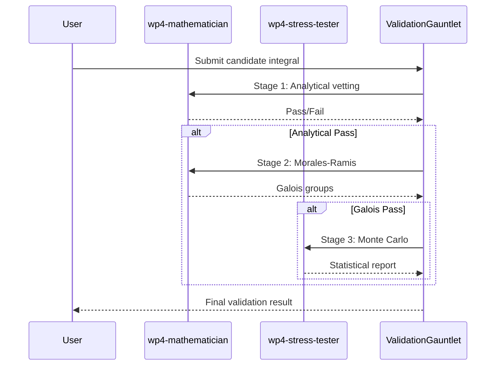

# 3Body Agent System: User Guide

**Document Version**: 1.0
**Date**: 2025-11-24
**Purpose**: Comprehensive guide to using and modifying the 3Body project's agentic architecture

---

## Table of Contents

1. [Overview](#overview)
2. [Quick Start](#quick-start)
3. [Agent Architecture](#agent-architecture)
4. [Using the Agents](#using-the-agents)
5. [Modifying Agents](#modifying-agents)
6. [Skills System](#skills-system)
7. [Flight Recorder Logs](#flight-recorder-logs)
8. [Troubleshooting](#troubleshooting)
9. [Advanced Topics](#advanced-topics)

---

## Overview

The 3Body project uses an **agentic architecture** with 12 specialized agents and 11 skills to handle complex scientific computing tasks. This system enables Claude Code to delegate work efficiently while maintaining research rigor and reproducibility.

### What are Agents?

**Agents** are specialized AI assistants that handle specific domains of work:
- **Work Package (WP) Agents** (10 total): Handle research, implementation, validation, and publication
- **Diagram Agents** (2 total): Generate and validate architectural diagrams

### What are Skills?

**Skills** are navigation and routing tools that:
- Determine which agent should handle a task
- Provide quick reference information
- Point to source code (never duplicate it)

### Architecture Principles

1. **Single Source of Truth (SSOT)**: Skills reference code, never duplicate it
2. **Role-Based Consolidation**: Agents organized by persona (Builder vs. Critic), not micro-tasks
3. **Auditability**: Flight Recorder logs document all research decisions
4. **Quality Gates**: Automated hooks enforce testing and formatting standards

---

## Quick Start

### For Users: Invoking Agents

When working with Claude Code on this project, you can invoke agents in two ways:

#### Method 1: Natural Language (Recommended)
Simply describe what you want to do. Claude Code will automatically route to the appropriate agent.

**Examples**:
```
"Generate 1000 high-precision trajectories"
→ Routes to wp1-lab-director

"Build the KS spinor lift construction"
→ Routes to wp2-architect

"Search for conserved quantities using symbolic regression"
→ Routes to wp3-investigator

"Validate this candidate integral: u1**2 + u2**2"
→ Routes to wp4-mathematician

"Write the introduction section for the manuscript"
→ Routes to wp5-author

"Show me the system architecture"
→ Routes to diagram-c4 (via project-navigator)
```

#### Method 2: Explicit Skill Invocation
You can directly invoke navigation skills:

```
"Use wp-navigator to help me with WP2 tasks"
→ Loads wp-navigator skill, shows delegation matrix

"Use project-navigator to answer architectural questions"
→ Routes architectural questions to diagram skills
```

### For Developers: Testing Agent Changes

After modifying an agent:

```bash
# 1. Verify agent file syntax
cat .claude/agents/wp1-lab-director.md

# 2. Test with a simple task
# In Claude Code session:
"Test wp1-lab-director by running environment verification"

# 3. Check Flight Recorder was created
ls -la data/tier1/session_log.md
```

---

## Agent Architecture

### System Diagram

```
User Request
     ↓
Main Claude Code Agent
     ↓
┌────────────────┴─────────────────┐
│                                  │
│  Navigation Skills (Tier 1)     │
│  ┌──────────────────────────┐   │
│  │ wp-navigator             │   │ ← Routes WP tasks
│  │ project-navigator        │   │ ← Routes architectural questions
│  └──────────────────────────┘   │
│                                  │
└────────┬─────────────────────────┘
         ↓
┌────────┴──────────────────────────────────────────┐
│                                                    │
│  WP Agents (10)              Diagram Agents (2)   │
│  ├── wp1-lab-director        ├── abstraction-architect (builder)
│  ├── wp2-architect           └── abstraction-analyst (critic)
│  ├── wp2-analyst
│  ├── wp3-investigator
│  ├── wp3-consolidator
│  ├── wp4-mathematician
│  ├── wp4-stress-tester
│  ├── wp5-author
│  ├── wp5-librarian
│  └── research-orchestrator
│                                                    │
└────────────────────────────────────────────────────┘
```

### Agent Roles and Responsibilities

#### WP1: High-Precision Trajectory Generation

**wp1-lab-director** (Builder)
- **Role**: End-to-end trajectory generation pipeline
- **Tasks**: Configure integrators, run production runs, validate precision, package data
- **Files**: `.claude/agents/wp1-lab-director.md`
- **Invoke when**: "Generate trajectories", "Run production integration", "Package WP1 data"

#### WP2: Geometric Foundations

**wp2-architect** (Builder)
- **Role**: Geometric construction (creative)
- **Tasks**: Build coordinate systems, principal bundles, S¹/KS lifts
- **Files**: `.claude/agents/wp2-architect.md`
- **Invoke when**: "Implement KS lift", "Build connection form", "Create coordinate transform"

**wp2-analyst** (Critic)
- **Role**: Geometric verification (critical)
- **Tasks**: Compute curvature, test integrability, validate symplectic structure
- **Files**: `.claude/agents/wp2-analyst.md`
- **Invoke when**: "Compute curvature", "Test holonomy", "Validate symplectic form"

#### WP3: Invariant Discovery

**wp3-investigator** (Builder)
- **Role**: Multi-method integral discovery
- **Tasks**: Run PDE solvers, train HNNs, execute symbolic regression
- **Files**: `.claude/agents/wp3-investigator.md`
- **Invoke when**: "Search for integrals", "Run symbolic regression", "Train Hamiltonian NN"

**wp3-consolidator** (Critic)
- **Role**: Filter and rank candidates
- **Tasks**: Remove trivial results, deduplicate, prioritize by novelty
- **Files**: `.claude/agents/wp3-consolidator.md`
- **Invoke when**: "Filter trivial integrals", "Rank candidates", "Deduplicate results"

#### WP4: Validation Gauntlet

**wp4-mathematician** (Analytical)
- **Role**: Rigorous mathematical validation
- **Tasks**: Compute Poisson brackets, run Morales-Ramis test, write proofs
- **Files**: `.claude/agents/wp4-mathematician.md`
- **Invoke when**: "Test conservation", "Run Morales-Ramis", "Prove integrability"

**wp4-stress-tester** (Numerical)
- **Role**: Robustness across parameter space
- **Tasks**: Monte Carlo sweeps, stress scenarios, long-time validation
- **Files**: `.claude/agents/wp4-stress-tester.md`
- **Invoke when**: "Validate numerically", "Test across chaotic orbits", "Stress test"

#### WP5: Publication and Archival

**wp5-author** (Writer)
- **Role**: Manuscript preparation
- **Tasks**: Write LaTeX sections, compose proofs, design publication figures
- **Files**: `.claude/agents/wp5-author.md`
- **Invoke when**: "Write introduction", "Create theorem proof", "Design figure"

**wp5-librarian** (Archival)
- **Role**: Code release and reproducibility
- **Tasks**: Clean code, audit reproducibility, package for Zenodo
- **Files**: `.claude/agents/wp5-librarian.md`
- **Invoke when**: "Prepare code for release", "Package for Zenodo", "Audit reproducibility"

#### Meta-Orchestration

**research-orchestrator** (Strategic)
- **Role**: High-level multi-WP planning
- **Tasks**: Cross-WP coordination, research pivots, resource allocation
- **Files**: `.claude/agents/research-orchestrator.md`
- **Invoke when**: "Plan validation pipeline", "Recommend next step", "Allocate resources"

#### Architectural Analysis

**abstraction-architect** (Builder)
- **Role**: Extract architecture, generate diagrams
- **Tasks**: Create C4, Sequence, ERD, State Machine diagrams
- **Files**: `.claude/agents/abstraction-architect.md`
- **Invoke when**: Routed via `project-navigator` for diagram generation

**abstraction-analyst** (Critic)
- **Role**: Validate diagrams against rules
- **Tasks**: Check abstraction compliance, report violations
- **Files**: `.claude/agents/abstraction-analyst.md`
- **Invoke when**: Automatically invoked after diagram generation

---

## Using the Agents

### Workflow Patterns

#### Pattern 1: Single WP Task (Direct Delegation)

**Scenario**: You need to generate trajectories for WP1.

**Steps**:
1. User: "Generate 100 trajectories with double-double precision"
2. Claude Code: Analyzes request → Invokes `wp1-lab-director`
3. wp1-lab-director:
   - Verifies QD library installation
   - Configures Snakemake pipeline
   - Launches integration jobs
   - Creates `session_log.md` in `data/tier1/`
   - Returns summary report
4. Claude Code: Presents results to user

**Expected Output**:
```
Production Run Summary:
- Total orbits: 100
- Completed: 98 (98%)
- Failed: 2 (2%)
- Precision: 97% meet |ΔC/C| < 10^-25
- Elapsed time: 2.3 hours
- Flight Recorder: data/tier1/session_log.md
```

#### Pattern 2: Multi-WP Pipeline (Orchestrated)

**Scenario**: You discovered a candidate integral and want to validate it completely.

**Steps**:
1. User: "I found a candidate integral: u1**2 + u2**2. Run the full validation pipeline."
2. Claude Code: Invokes `research-orchestrator`
3. research-orchestrator:
   - Plans 3-phase pipeline: Analytical → Morales-Ramis → Monte Carlo
   - Delegates Phase 1 to `wp4-mathematician`
   - Delegates Phase 2 to `wp4-mathematician` (Morales-Ramis specialist)
   - Delegates Phase 3 to `wp4-stress-tester`
   - Aggregates results
4. Claude Code: Presents consolidated validation report

**Expected Output**:
```
Validation Pipeline Results:
━━━━━━━━━━━━━━━━━━━━━━━━━━━━━
Phase 1: Analytical Vetting (wp4-mathematician)
  ✓ Conservation: {I, H} < 10^-14
  ✓ Involution: {I, L} < 10^-14
  ✓ Independence: rank = 2

Phase 2: Morales-Ramis Test (wp4-mathematician)
  ✓ Downstairs Galois: SL(2,C) (non-integrable)
  ✓ Upstairs Galois: C* (INTEGRABLE!)

Phase 3: Numerical Robustness (wp4-stress-tester)
  ✓ Monte Carlo (10^6 trajectories): 99.7% pass
  ✓ Stress scenarios: 5/5 pass
  ✓ Long-time (10^5 periods): Bounded drift

CONCLUSION: VALIDATED - Novel lift-integral confirmed
```

#### Pattern 3: Architectural Question (Diagram Generation)

**Scenario**: You want to understand the validation workflow.

**Steps**:
1. User: "How does the validation gauntlet work?"
2. Claude Code: Invokes `project-navigator` skill
3. project-navigator: Routes to `diagram-sequence` (Time abstraction)
4. diagram-sequence: Invokes `abstraction-architect`
5. abstraction-architect:
   - Traces workflow through `src/python/validation/`
   - Generates Sequence diagram
   - Writes to `diagrams/sequence/validation_workflow.mmd`
6. abstraction-analyst: Validates diagram against Sequence rules
7. Claude Code: Displays diagram to user

**Expected Output**:


### Agent Communication Patterns

#### Builder-Critic Pairs

Some WP domains use paired agents (Builder creates, Critic validates):

**WP2 Example**:
```
User: "Implement and validate the S¹ lift"

→ wp2-architect (Builder):
   - Implements `src/python/lifts/s1_lift.py`
   - Writes test `tests/symbolic_lifts/test_s1_lift.py`
   - Returns: "S¹ lift implemented, ready for validation"

→ wp2-analyst (Critic):
   - Reads implementation
   - Computes lifted Hamiltonian
   - Tests symplectic structure preservation
   - Validates on Lagrange L4 orbit
   - Returns: "Validation complete: symplectic error < 10^-14"
```

**When to use paired agents**:
- Use Builder for **implementation** (creative, construction)
- Use Critic for **verification** (critical, testing)
- Invoke sequentially, not in parallel

#### Investigator-Consolidator Pattern

**WP3 Example**:
```
User: "Search for new integrals using all methods"

→ wp3-investigator (Discovery):
   - Runs PDE solver (Hamilton-Jacobi)
   - Trains Hamiltonian Neural Network
   - Executes symbolic regression (3 bases)
   - Returns: 147 candidate integrals

→ wp3-consolidator (Filtering):
   - Removes 132 trivial integrals (C, L, combinations)
   - Deduplicates 8 equivalent expressions
   - Ranks remaining 7 by novelty
   - Returns: Top 5 candidates for validation
```

---

## Modifying Agents

### Agent File Structure

Each agent is defined in a Markdown file with YAML frontmatter:

**Location**: `.claude/agents/<agent-name>.md`

**Template**:
```markdown
---
name: agent-name
description: One-sentence description of when to invoke this agent
---

# Agent Name

You are the **Role** for [domain].

## Mission
[What is this agent's core responsibility?]

## Source of Truth
**Read** these files before any work:
- `path/to/code.py` - Description
- `User-Guides/User-Guide-WPX.md` - Detailed specifications

## Capabilities

### 1. Capability Name
[Detailed description]

**Workflow**:
1. Step 1
2. Step 2
3. Step 3

**Tool**: `path/to/implementation.py`

### 2. Capability Name
[...]

## Testing Protocol
**ALWAYS** run tests before reporting success:
```bash
pytest tests/path/ -v
```

## Flight Recorder Requirement
Maintain `path/to/session_log.md` with:
- [Required information 1]
- [Required information 2]

## Deliverables
Report must include:
1. [Deliverable 1]
2. [Deliverable 2]
```

### Modification Guidelines

#### When to Modify an Agent

**Add capabilities when**:
- New functionality added to codebase (e.g., new integrator)
- User guide updated with new procedures
- Test suite expanded with new validation methods

**Update workflows when**:
- Implementation details change (e.g., API refactored)
- File paths reorganized
- Dependencies changed

#### How to Modify Safely

**1. Read-First Principle**

❌ **WRONG** - Don't add implementation code to agent:
```markdown
## Compute Curvature

**Implementation**:
```python
def compute_curvature(q):
    A = connection_form(q)
    dA = exterior_derivative(A)
    return dA + wedge(A, A)
```
```

✅ **CORRECT** - Point to source code:
```markdown
## Compute Curvature

**File**: `src/python/geometry/curvature_form.py`

**Usage**:
```python
from src.python.geometry.curvature_form import CurvatureForm
F = CurvatureForm()
curvature = F.compute(q_shape)
```

**Theory**: See `User-Guides/User-Guide-WP2.md` Section 3.2
```

**Why**: If implementation code is in the agent, it becomes outdated when source code changes. Agents should **reference**, not **duplicate**.

**2. Test Your Changes**

After modifying an agent:

```bash
# 1. Verify Markdown syntax
cat .claude/agents/wp1-lab-director.md

# 2. Test agent with simple task (in Claude Code session)
"Test wp1-lab-director: verify QD library installation"

# 3. Verify agent reads correct files
# Check agent's "Source of Truth" section matches current codebase structure
ls -la src/python/integrators/

# 4. Commit changes
git add .claude/agents/wp1-lab-director.md
git commit -m "Update wp1-lab-director: add Yoshida8 integrator workflow"
```

**3. Update Delegation Matrix**

If you add/remove agents, update the navigation skills:

**File to edit**: `.claude/skills/wp-navigator/SKILL.md`

Find the "Subagent Delegation Matrix" section and update:

```markdown
| Task Description | Delegate To | Rationale |
|------------------|-------------|-----------|
| Generate trajectories | wp1-lab-director | End-to-end data pipeline |
| NEW TASK HERE | new-agent-name | Justification |
```

#### Common Modifications

**Example 1: Add New Integrator to wp1-lab-director**

**File**: `.claude/agents/wp1-lab-director.md`

**Change**:
```markdown
## Capabilities

### Integration Methods
**Available**: IAS15, Adaptive Symplectic, Yoshida8, **NEW: Gauss-Legendre**

**Read** these files:
- `src/python/integrators/ias15.py`
- `src/python/integrators/adaptive_symplectic.py`
- `src/python/integrators/yoshida8.py`
- `src/python/integrators/gauss_legendre.py` ← NEW

**Decision Matrix**: See `User-Guides/User-Guide-WP1.md` Section 2.1
```

**Example 2: Add Flight Recorder Enforcement**

If an agent doesn't have Flight Recorder requirements:

```markdown
## Flight Recorder Requirement
Maintain `<work_directory>/session_log.md` with:
- Number of experiments attempted
- Success/failure rates
- File paths to artifacts
- Next recommended steps

**Template**: See `Claude-Agent-Docs/Flight-Recorder-Template.md`

**CRITICAL**: Do NOT report success without citing specific log entries.
```

---

## Skills System

### Skill vs. Agent

**Skill**:
- Navigation/routing tool
- Provides quick reference
- Points to source code
- Loaded into main Claude Code context

**Agent**:
- Specialized worker
- Executes complex tasks
- Isolated context (doesn't pollute main conversation)
- Invoked by skills

**Analogy**: Skill = GPS, Agent = Driver

### Skill File Structure

**Location**: `.claude/skills/<skill-name>/SKILL.md`

**Template**:
```markdown
---
name: skill-name
description: One-sentence description of when to use this skill
---

# Skill Name

## Source of Truth
- **Code**: `path/to/code/`
- **User Guide**: `User-Guides/User-Guide-WPX.md`
- **Tests**: `tests/path/`

## Workflow

### 1. Step Name
[Description]

**Read** these files: [file paths]

### 2. Step Name
[...]

## Quick Reference
```bash
# Common commands
command1
command2
```
```

### Modifying Skills

**When to modify**:
- Codebase structure changes (directories reorganized)
- User guides updated
- New common workflows identified

**Example: Update wp2-geometric-library skill**

**File**: `.claude/skills/wp2-geometric-library/SKILL.md`

**Scenario**: New module `src/python/geometry/torsion.py` added

**Change**:
```markdown
### Geometric Objects
**Location**: `src/python/geometry/`

**Key files**:
- `connection_form.py` - Mechanical connection (1-form)
- `curvature_form.py` - Curvature (2-form)
- `metric.py` - Riemannian metric
- `torsion.py` - Torsion tensor (NEW)

**Workflow**: See `User-Guides/User-Guide-WP2.md` Section 2
```

---

## Flight Recorder Logs

### Purpose

Flight Recorder logs provide **scientific audit trails** for research tasks:
- Document hypotheses and experimental methods
- Record negative results (as important as positive!)
- Enable reproducibility
- Support peer review

### When Required

Flight Recorder is **MANDATORY** for:
- WP3 tasks (discovery)
- WP4 tasks (validation)
- Any research task with multiple experimental attempts

Flight Recorder is **OPTIONAL** for:
- WP1 tasks (engineering, not research)
- WP2 tasks (deterministic implementations)
- WP5 tasks (writing, archival)

### Structure

**Template Location**: `Claude-Agent-Docs/Flight-Recorder-Template.md`

**Required Sections**:
1. **Objective**: What are we trying to achieve?
2. **Hypothesis**: Specific, testable claim
3. **Experimental Log**: Each attempt documented (method, results, evidence)
4. **Summary**: Validated/rejected hypotheses, next steps
5. **Artifacts**: Table of all generated files

### Example

```markdown
# Flight Recorder: Search for Spinor-Space Integrals

**Agent**: wp3-investigator
**Session ID**: 3body-wp3-20251124-143022
**Date**: 2025-11-24T14:30:22Z
**Status**: Completed

---

## Objective
Search for novel conserved quantities in KS spinor space using symbolic regression.

**Hypothesis**: Polynomial integrals of degree ≤6 exist in spinor coordinates.

**Success Criteria**: Conservation error < 10^-12 over 10^4 test trajectories.

---

## Experimental Log

### Experiment 1: Spinor Basis (Degree ≤4)
**Timestamp**: 2025-11-24T14:32:15Z

**Approach**:
- Basis: 80 spinor functions from `src/python/symbolic/spinor_basis.py`
- Algorithm: PySR with 12-hour timeout
- Data: 10^4 trajectories from `data/tier1/parquet/`

**Execution**:
```bash
python -m src.python.symbolic.multi_stage_pipeline \
  --basis spinor --max_complexity 10 --timeout 12h
```

**Results**:
- **Outcome**: Partial success
- **Metrics**: Found 47 candidates, 45 were trivial (C, L combinations)
- **Evidence**:
  - Data: `discovery_logs/spinor_candidates.csv`
  - Plots: `discovery_logs/pareto_front_spinor.png`

**Analysis**: Most candidates are rediscoveries of known integrals.

**Conclusion**: Need to filter trivials before reporting. Delegate to wp3-consolidator.

---

### Experiment 2: Extended Spinor Basis (Degree ≤6)
**Timestamp**: 2025-11-24T18:45:33Z

**Approach**: Expanded basis to degree 6 (312 functions)

**Results**:
- **Outcome**: Failure
- **Metrics**: PySR timed out after 12 hours, no convergence
- **Evidence**: `discovery_logs/pysr_timeout.log`

**Analysis**: Search space too large for brute-force symbolic regression.

**Conclusion**: Pivot to Hamiltonian Neural Networks (pre-filters search space).

---

## Summary

**Successful Hypotheses**:
- Spinor space contains conserved quantities (rediscovered C, L in spinor coordinates)

**Failed Hypotheses**:
- Novel polynomial integrals of degree 4-6 NOT found in 24-hour search

**Open Questions**:
- Do non-polynomial integrals (elliptic, theta) exist in spinor space?

**Recommended Next Steps**:
1. Try elliptic basis (Experiment 3)
2. Train HNN to narrow search space before symbolic regression

---

## Artifacts

| File Path | Type | Description |
|-----------|------|-------------|
| `discovery_logs/spinor_candidates.csv` | Data | 47 candidates (45 trivial) |
| `discovery_logs/pareto_front_spinor.png` | Plot | Complexity vs. Conservation Error |
| `discovery_logs/pysr_timeout.log` | Log | Degree-6 timeout details |
```

### Enforcement

Agents enforce Flight Recorder via:

1. **System Prompt Requirement**: All WP3/WP4 agents instructed to create `session_log.md`
2. **Automated Hook**: `.claude/settings.json` checks for log existence before task completion
3. **Report Requirement**: Agents must cite log entries when reporting results

---

## Troubleshooting

### Common Issues

#### Issue 1: Agent Not Invoked

**Symptom**: You request a WP2 task, but Claude Code doesn't invoke `wp2-architect`.

**Diagnosis**:
1. Check if request is clear: "Build KS lift" vs. "Tell me about KS"
2. Verify agent file exists: `ls .claude/agents/wp2-architect.md`
3. Check delegation matrix in `wp-navigator` skill

**Solution**:
```
# Explicit invocation
"Use wp-navigator, then delegate to wp2-architect to build KS lift"
```

#### Issue 2: Agent References Outdated Code

**Symptom**: Agent tries to import `old_module.py` that was refactored to `new_module.py`.

**Diagnosis**: Agent's "Source of Truth" section outdated.

**Solution**:
1. Edit `.claude/agents/agent-name.md`
2. Update file paths:
   ```markdown
   ## Source of Truth
   - ~~`src/python/old_module.py`~~ (DEPRECATED)
   - `src/python/new_module.py` (CURRENT)
   ```
3. Test agent with simple task
4. Commit changes

#### Issue 3: Flight Recorder Not Created

**Symptom**: Research task completes but no `session_log.md` found.

**Diagnosis**: Agent didn't follow Flight Recorder requirement.

**Solution**:
1. Check agent's system prompt has Flight Recorder section
2. Verify hook is enabled: `cat .claude/settings.json | grep BeforeTaskCompletion`
3. Manually create log (for now) and update agent file

#### Issue 4: Skill Points to Non-Existent File

**Symptom**: Skill references `User-Guides/User-Guide-WP6.md` which doesn't exist.

**Diagnosis**: Skill not updated after codebase reorganization.

**Solution**:
1. Edit `.claude/skills/skill-name/SKILL.md`
2. Update file paths to current structure
3. Test skill invocation

---

## Advanced Topics

### Creating New Agents

**When to create a new agent**:
- New Work Package added (WP6, WP7, ...)
- Existing agent becomes too large (>1000 lines)
- New domain requires specialized expertise

**Steps**:

1. **Define Role and Scope**
   ```markdown
   Agent Name: wp6-optimizer
   Role: Optimize computational performance
   Scope: Profile code, benchmark algorithms, recommend parallelization
   ```

2. **Create Agent File**
   ```bash
   cp .claude/agents/template.md .claude/agents/wp6-optimizer.md
   ```

3. **Fill Template Sections**
   - Mission
   - Source of Truth (file paths)
   - Capabilities (workflows)
   - Testing Protocol
   - Flight Recorder Requirement (if research)
   - Deliverables

4. **Update Delegation Matrix**
   Edit `.claude/skills/wp-navigator/SKILL.md`:
   ```markdown
   | Optimize code performance | wp6-optimizer | Profiling and benchmarking |
   ```

5. **Test Agent**
   ```
   "Test wp6-optimizer: profile the adaptive_symplectic integrator"
   ```

6. **Document in WPSkillsDocs**
   Add to `Claude-Agent-Docs/WPSkillsDocs/WP6_Skills_Agents_List.MD`

### Extending the Diagram System

**Scenario**: You want to add a new diagram type (e.g., Deployment diagram).

**Steps**:

1. **Create Skill**
   ```bash
   mkdir -p .claude/skills/diagram-deployment
   touch .claude/skills/diagram-deployment/SKILL.md
   touch .claude/skills/diagram-deployment/references/rules.md
   ```

2. **Define Abstraction**
   Deployment diagrams map to **Infrastructure abstraction** (where things run).

3. **Write Skill**
   ```markdown
   ---
   name: diagram-deployment
   description: Generate deployment diagrams showing where components run
   ---

   # Deployment Diagram Generator (Infrastructure Abstraction)

   ## When to Use
   User asks: "Where does X run?", "What's the deployment architecture?"

   ## Workflow
   1. Extract deployment info (Docker, Kubernetes, cloud services)
   2. Generate Mermaid deployment diagram
   3. Validate against rules (nodes, artifacts, connections)
   ```

4. **Update Project Navigator**
   Edit `.claude/skills/project-navigator/SKILL.md`:
   ```markdown
   | Infrastructure questions (where deployed) | diagram-deployment |
   ```

5. **Test**
   ```
   "Show me the deployment architecture"
   → Should route to diagram-deployment
   ```

### Multi-Agent Orchestration Patterns

**Pattern**: Sequential Pipeline (Stage 1 → Stage 2 → Stage 3)

**Example**: Validation Gauntlet
```
research-orchestrator:
  ├─→ wp4-mathematician (Stage 1: Analytical)
  │   └─→ Result: PASS
  ├─→ wp4-mathematician (Stage 2: Morales-Ramis)
  │   └─→ Result: PASS (Galois = C*)
  └─→ wp4-stress-tester (Stage 3: Monte Carlo)
      └─→ Result: PASS (99.7% success)
```

**Implementation**: research-orchestrator delegates sequentially, waits for each completion.

**Pattern**: Parallel Investigation (Method 1 || Method 2 || Method 3)

**Example**: WP3 Discovery
```
wp3-investigator:
  ├─→ PDE Solver (Hamilton-Jacobi)    [parallel]
  ├─→ HNN Trainer (Neural Network)    [parallel]
  └─→ Symbolic Regression (PySR)      [parallel]
      ↓
  wp3-consolidator: Deduplicate results
```

**Implementation**: wp3-investigator runs all methods, then consolidates.

---

## Summary

### Quick Reference Card

```
┌─────────────────────────────────────────────────────────┐
│ 3Body Agent System Quick Reference                     │
├─────────────────────────────────────────────────────────┤
│ NAVIGATION SKILLS                                       │
│   wp-navigator        → Routes WP tasks                 │
│   project-navigator   → Routes architectural questions  │
│                                                         │
│ WP AGENTS (10)                                          │
│   wp1-lab-director    → Trajectory generation           │
│   wp2-architect       → Geometric construction          │
│   wp2-analyst         → Geometric verification          │
│   wp3-investigator    → Integral discovery              │
│   wp3-consolidator    → Result filtering                │
│   wp4-mathematician   → Analytical validation           │
│   wp4-stress-tester   → Numerical validation            │
│   wp5-author          → Manuscript writing              │
│   wp5-librarian       → Code release                    │
│   research-orchestrator → Multi-WP planning             │
│                                                         │
│ DIAGRAM AGENTS (2)                                      │
│   abstraction-architect → Generate diagrams             │
│   abstraction-analyst   → Validate diagrams             │
│                                                         │
│ FILES TO MODIFY                                         │
│   Agents:    .claude/agents/<name>.md                   │
│   Skills:    .claude/skills/<name>/SKILL.md             │
│   Hooks:     .claude/settings.json                      │
│   Logs:      <work_dir>/session_log.md                  │
│                                                         │
│ KEY PRINCIPLES                                          │
│   ✓ Skills REFERENCE code, never duplicate             │
│   ✓ Research tasks REQUIRE Flight Recorder             │
│   ✓ Agents READ source files, never guess              │
│   ✓ Builder-Critic pairs for construction-validation   │
└─────────────────────────────────────────────────────────┘
```

### Further Reading

- **Implementation Plan**: `Claude-Agent-Docs/WPSkillsDocs/Implementation-Plan-Agents-for-3Body.MD`
- **WP-Specific Docs**: `Claude-Agent-Docs/WPSkillsDocs/WP[1-5]_Skills_Agents_List.MD`
- **Flight Recorder Template**: `Claude-Agent-Docs/Flight-Recorder-Template.md`
- **User Guides**: `User-Guides/User-Guide-WP[1-5].md`
- **Main Project Instructions**: `CLAUDE.md`

---

**Document Status**: ✅ Complete
**Last Updated**: 2025-11-24
**Maintainer**: 3Body Project Team
